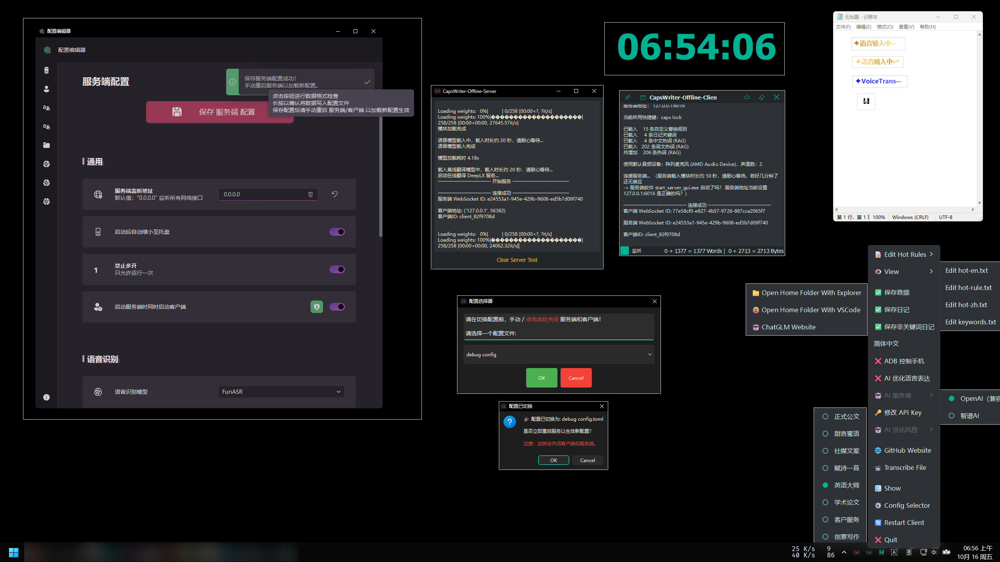

# 😘 CapsWriter-Offline 图形界面包分支 （ 仅  <span style="color: #4ABAFF;">[Windows 10+](https://www.microsoft.com/zh-cn/windows) </span> ）



#  <span style="color: #4ABAFF;">[Windows](https://www.microsoft.com/zh-cn/windows)</span> 端离线语音输入简/繁体、中译英、字幕转录；在线多译多、云剪贴板等等

> [!IMPORTANT]
> 图形化配置界面 `edit_config_gui.exe`，覆盖 `config.toml` 的全部配置项（含提示词、API Key、ADB 控制、快捷键），写入前预览 diff 并自动备份

## 😎 十五个功能

1. 按下键盘上的大写锁定键 `CapsLock` ，录音开始，当松开大写锁定键时，就会识别你的录音，并将识别结果立刻输入
2. 按下键盘上的 `Left Shift` 再按 `CapsLock` 可以将识别结果离线翻译为英文，当松开大写锁定键时，将翻译结果立刻输入
3. 按下键盘上的 `Right Shift` 再按 `CapsLock` 可以将识别结果在线翻译（[LibreTranslate](https://github.com/LibreTranslate/LibreTranslate) / [DeepLX](https://github.com/OwO-Network/DeepLX)）为多国语言，默认设置翻译为日文，当松开大写锁定键时，将翻译结果立刻输入
4. 将音视频文件拖动到客户端 `start_client_gui.exe` 打开，即可转录生成 srt 字幕
5. 按下客户端主界面的  按钮，即可将客户端文本框中内容发布到 [云剪贴板](https://share.lanol.cn) ，并生成获取链接和二维码
6. 快速双击 `CapsLock` ，可语音输入繁体。还可通过托盘图标右键菜单快速切换简/繁体配置
7. 可通过 `edit_config_gui.exe` 图形化配置界面安全地修改客户端/服务端配置，也可手动修改 `config.toml` 文件
8. 可通过客户端托盘菜单 热切换 是否启用 AI 优化语言表达 以及 AI 服务商、修改 API Key 和 AI 优化风格
9. 可快捷键切换 AI优化语言表达 提示风格
10. 可在鼠标离开客户端界面时 变为数字时钟
11. 可录音时自动 `静音` 或 `暂停` 其他音频播放（暂停主要由模拟播放软件全局快捷键实现），也可启用 `enable_adb_control` 后通过 ADB 控制手机静音并暂停播放
12. 可通过 `config_selector.exe` 选择配置文件
13. 客户端文本框是一个多光标编辑器：`Alt+点击` 加副光标、`Alt+拖拽` 矩形列选、`Ctrl+D` 选词、`Ctrl+F` 查找、`Ctrl+H` 替换，键位与 VS Code 默认一致；中文按 jieba 词典分词
14. 客户端文本框使用等宽字体 **Maple Mono NF CN**，长行折行后仍逐格对齐（字号会自动吸附到 2:1 网格点）
15. 服务端可选 4 种语音识别模型：`FunASR`、`Sensevoice`、`Paraformer`、`QwenCTC`（Qwen3-ASR + CTC 头，输出带字级时间戳；可选 CTC 首遍 + LLM 二遍）

- [✨ 特性](#-特性)
- [⬇️ 下载地址](#-下载地址)
- [❗ 注意事项](#-注意事项)
- [📜 开源许可](#-开源许可)
- [🤓 源码运行](#-源码运行)
- [🔧 修改配置](#-修改配置)
- [🪳 提交 Bug](https://github.com/H1DDENADM1N/CapsWriter-Offline/issues)

# 👀 最新更新

<details>
<summary><h1">展开最近更新</h1></summary>

## 新增 可选模型 `QwenCTC`（Qwen3-ASR + CTC 头）
>
> 服务端新增第 4 个可选语音识别模型 `QwenCTC`：Qwen3-ASR 编码器（ONNX，int4）+ CTC 头，纯 CPU 推理，**输出带字级时间戳**，可直接转录生成 SRT 字幕。
>
> 在 `config.toml` 中设置 `model = "QwenCTC"` 启用，模型文件按 [models/模型下载方式.txt](models/模型下载方式.txt) 下载到 `models/qwen-ctc-aiinfra4/`。
>
> 特点：纯 CTC 模式无 LLM 二遍，识别速度快（30 秒音频约 2 秒）、内存占用小；支持中英混说；标点由服务端自带的标点模型补全（`format_punc`）。配置 `[model_paths].qwen_llm_path`（LLM 解码器 GGUF）后，还可以切换「CTC 首遍 + LLM 二遍」或「纯 LLM」模式，文本与标点更好，但更慢、更占内存。**注意：`config.toml` 模板里该键已预填 1.7B 解码器路径，所以出厂默认就是「两遍」模式，首次启动需要先按 [models/模型下载方式.txt](models/模型下载方式.txt) 下载 1.28 GB 的解码器；不想要就把它留空退回纯 CTC。**
>
> 该模型有三种运行模式，由 `[model_paths].qwen_llm_path` 与 `[qwen_ctc_args].enable_ctc` 共同决定：
>
> | `qwen_llm_path` | `enable_ctc` | 模式 | 输出 |
> | --- | --- | --- | --- |
> | 留空 | 不生效 | 纯 CTC（留空即回到 1.0.7 的现状） | 文本 + **字级时间戳** |
> | 非空 | `true`（默认） | 两遍：CTC 首遍 → LLM 二遍 | LLM 文本（自带标点）+ 经 Needleman-Wunsch（NW）对齐到 LLM 文本的 CTC 字级时间戳 |
> | 非空 | `false` | 纯 LLM | 只有 LLM 文本，**无时间戳** |
>
> 0.6B 版本：`qwen3_asr_llm.q4_k.gguf`（hidden 1024）**必须配 0.6B 自己的编码器前后端 ONNX**（`models/qwen-ctc-aiinfra4-06b/`，下载命令见 [models/模型下载方式.txt](models/模型下载方式.txt)）；1.7B 的融合编码器输出 2048 维，与 0.6B 解码器不兼容。0.6B **没有 CTC 头**，只能纯 LLM / 两遍模式下 CTC 首遍会被自动跳过（引擎打 WARNING 后按纯 LLM 跑）。
>
> ⚠️ 官方提供的 `aiinfra4` 版 CTC 头在**AI 技术领域的英文内容**上会把英文词转写成对应中文译文（如 `we` → `我们`），详见 [Qwen3-CTC-语言串味问题排查](docs/Qwen3-CTC-语言串味问题排查.md)。建议改用 `Qwen3-ASR-CTC.v1.fp16.onnx`（v1 头），在 `config.toml` 的 `[model_paths]` 里加一行 `qwen_ctc_ctc_path = "models/qwen-ctc-aiinfra4/Qwen3-ASR-CTC.v1.fp16.onnx"` 即可（默认就是 v1 头）。
>
> 客户端无需任何改动：服务端/客户端协议未变，转录文件、简繁转换、翻译全部照常工作。唯一的差别是**纯 LLM 模式没有字级时间戳**，因此不生成 SRT 字幕（txt / json / merge.txt 照常落盘），客户端日志会说明「当前识别模式没有字级时间戳，未生成 SRT 字幕」。

## 客户端文本框升级为多光标编辑器，键位与 VS Code 对齐
>
> 客户端日志框不再只是只读滚动窗口，而是一个真正的编辑器：新增 `util/client/multicursor_edit.py` 独立引擎（`MultiCursorTextEdit`），支持 `Alt+点击` 加副光标、`Alt+拖拽` 矩形列选、`Ctrl+Alt+↑/↓` 加光标、`Ctrl+D` 选中当前词并追加下一个相同内容、`Ctrl+Shift+L` 全选相同内容、`Ctrl+U` 撤销最后一个副光标、`Esc` 收敛。
>
> 配套一整套 VS Code 默认编辑快捷键：`Ctrl+F` 查找、`Ctrl+H` 替换、`Ctrl+/` 注释、`Ctrl+Shift+K` 删行、`Alt+↑/↓` 移行、`Shift+Alt+↑/↓` 复制行。方向键、退格、删除、回车会同时作用于所有光标；一次输入只占一步撤销，`Ctrl+Z` 一次整体撤回。
>
> 全部替换只占**一步撤销**，且撤销时主光标与副光标一并回到替换前。

## 新增 文本框 VS Code 风格替换栏（`Ctrl+H`）
>
> 查找栏与替换栏共用同一个浮层：按 `Ctrl+F` 只显示查找行（与旧行为完全一致），按 `Ctrl+H` 展开第二行的替换行；两者都开着时按 `Ctrl+F` 不会收起替换行、也不会清空已输入的关键词。
>
> 替换语义对齐 VS Code：当前选区正好是一个匹配就替换它，否则定位下一个匹配并就地替换（连点即连续替换）；「全部替换」替换全文所有匹配并返回替换处数；替换词留空表示删除匹配。查找框 `Enter` 找下一个、`Shift+Enter` 找上一个；替换框 `Enter` 替换当前、`Ctrl+Alt+Enter` 全部替换。
>
> 已知局限：替换**不支持正则、不区分大小写**；替换前会收敛副光标（文本结果仍正确）。

## 新增 中文按词典分词选词（jieba），并修复 `Ctrl+D` 在中文下选不中词
>
> 此前词字符集合写死为 ASCII，中文日志里按 `Ctrl+D` 选不出词；且再次按下时选中的是文档里排在**最前面**的那一项，而不是下一个相同内容。
>
> 现在中文按 **jieba 词典分词**定位词边界（`语音输入` / `测试` / `字符串` 逐词跳），英文按整词（下划线词 `foo_bar` 不拆开），双击选词也同步收窄到词粒度。`Ctrl+←/→` 按词跳同样使用这一粒度，中文不再一次跳过整段汉字。

## 新增 文本框行首行尾与按词跳转
>
> `Alt+← / →` 跳到所在**视觉行**的行首 / 行尾（长行折行后跳的是当前那一屏行的开头 / 末尾，不是整段）；`Ctrl+← / →` 按词跳，中文按 jieba 词粒度。单光标与多光标行为此前不一致（多光标按字符跳），现已统一。

## 修复 长行折行后等宽字体错位、光标上下移动漂移
>
> 随包的 Maple Mono NF CN 设计上严格 2:1（汉字占两格），但 Qt 会把字符前进宽度量化到整数像素，12pt 下每个汉字少 1 像素、误差沿线累积，表现为折行后各行对不齐、光标上下移动时横向漂移。
>
> 现在字号在渲染前会**吸附**到「汉字宽度恰为半角两倍」的网格点（12pt 实际渲染为 12.38pt），5–45pt 共 41 档缩放全部落在网格上，网格偏差与跨行错位归零。用户意图的字号仍按整档保存。

## 修复 多光标删除后 `Ctrl+Z` 撤销时光标位置错乱
>
> Qt 的撤销栈只还原文本，不认识控件自有的副光标；且 `QTextEdit::undo()` 不是虚函数，覆写它拦不住 `Ctrl+Z`。现在多光标编辑前后各记一份光标快照，在按键分发处接管 `Ctrl+Z` / `Ctrl+Shift+Z` / `Ctrl+Y`，撤销时把主副光标集合（含选区）一并还原。

## 修复 取消置顶后窗口仍盖在别的窗口上面
>
> `setWindowFlag(Qt.WindowStaysOnTopHint, False)` 只清除原生的 `WS_EX_TOPMOST` **样式位**，并不改变窗口在 Z-order 中的位置——窗口仍滞留在原先置顶的位置，激活别的普通窗口也抬不过它。
>
> 现在取消置顶时会把窗口置于前台（`SetForegroundWindow`），窗口仍留在原位置、可见、可继续输入，只是不再永远置顶。

## 修复 右键菜单弹出后标题栏 / 底栏不再显示
>
> 右键菜单是独立的弹出窗口，弹出瞬间主窗口会收到一次 leave 事件；菜单关闭后若鼠标没有移动，Qt 不会再补发 enter 事件，于是标题栏 / 底栏被隐藏后再也回不来（开了时钟模式的话窗口会直接变成一块纯时钟）。现在菜单开合会主动同步一次界面状态。

## 修复 Alt 矩形列选改用像素模型，右击丢选区与「全选」被日志清空
>
> 旧实现用「块内字符下标」表达矩形选区，软换行会把一个块拆成多个视觉行，「列号」其实是块内偏移，折行处被整段吞掉或整段选上。现在改为**像素矩形 + 视觉行**模型，边界字符整个入选。
>
> 同时修掉两个缺陷：右击落在矩形包围盒内时不再清掉副光标（只保留主光标那一行）；监听模式下 `moveCursor(End)` 会顺手清掉选区，导致「全选」后下一条日志一到达选区就消失——现在有选区时不动光标。矩形选区还支持整块复制 / 剪切 / 删除。

## 修复 右侧贴边弹出后在屏幕右边缘反复闪烁
>
> `QRect.right()` 是**含端点**的坐标，而窗口覆盖的最右一列是 `x + width - 1`，两者差一像素就让屏幕最后一列落在窗口之外，形成「弹出 ↔ 贴回」的自激循环。现在右边界弹出坐标统一为 `right() - width + 1`，鼠标贴到屏幕右边缘时仍在窗口内。

## 配置编辑器：每个配置项配 Material Symbols 图形标志
>
> 左侧从「标题 + 说明」改成「图标列 + 文字列」：图标 24px，标题与说明整体右移并与图标左对齐（参照 Windows 设置的排版，说明文字换行时不会从图标下面绕过去）。搜索面板的结果行用同一个图标（保持 16px）。
>
> 161 个键逐项登记在 `lib/fieldIcons.ts`（另加按控件类型的兜底表），新增字段忘了配图标会在测试里红。

## 配置编辑器：搜索跳转改为定位到目标行并高亮闪烁一次
>
> 此前从搜索面板跳转、或点只读派生键的「跳转到『…』」，只切页**不滚动**，看起来像「跳到了页面最顶部」，目标项也没有任何提示——状态记下来了但没有组件消费。现在目标行会滚动到视口中部并播一次高亮；跳同一项也会再次滚动（跳转带自增计数，不依赖状态值是否变化）。

## 配置编辑器：进程状态栏提权检测与提权重启助手
>
> 状态栏左下圆点新增紫色态，表示服务端 / 客户端**以管理员权限运行**。需要重启提权进程时，编辑器会先做预检（一个进程都不结束），再通过 UAC 拉起一次性无窗口助手在提权上下文完成「结束 + 拉起」；UAC 取消时明确提示「已取消管理员授权（UAC），未做任何改动」。
>
> 同期修复 `taskkill` 在中文 Windows 下的乱码，并把失败区分为「进程不存在 / 拒绝访问 / 其它」，「拒绝访问」会明确提示需管理员权限。

## 新增 打包与清理脚本
>
> `dev/archive.ps1` 按 `dev/archive_list.txt` 清单打包发布用 7z 压缩包，源码树与构建中间产物一律不进包；压缩完成后自动计算 SHA-256 并打印可直接粘贴进发布说明的格式，同时复制到剪贴板。
>
> `dev/trim_pyside6.ps1` 可把 PySide6 / shiboken6 裁剪到最小运行时集合（约释放 580 MB），默认 dry run，加 `-Apply -BackupDir` 才真正裁剪并备份。

## 采用 MIT 许可并补齐开源合规材料
>
> 新增根目录 `LICENSE`（MIT 全文）与 `LICENSES/`（项目实际用到的 21 种许可证全文），逐项许可清单见 [开源许可.md](docs/开源许可.md)。三个包管理器的元数据（`pyproject.toml` / `package.json` / `Cargo.toml`）同步声明 `license = "MIT"`。
>
> 再分发前请先阅读 [开源许可.md](docs/开源许可.md) 第 12 节的合规风险清单与第 13 节的再发布检查清单。

## 配置编辑器改用 Material Design 3（m3-svelte），自动跟随 Windows 深浅色与主题色
>
> `edit_config_gui` 前端从手写样式迁移到 [m3-svelte](https://kendell.dev/m3-svelte/) 的 MD3 组件：侧栏、顶栏、状态栏、表单控件、下拉、保存预览与搜索面板全部换成 MD3 外观。深浅色与主题色来自注册表（`AppsUseLightTheme` 定深浅，`ColorizationColor` 与 `Control Panel\Colors\Hilight` 给主题色候选），前端每 3 秒轮询一次，在 Windows 设置里改完界面自己跟着变，没有额外开关。
>
> 同期：枚举下拉列表改为页面内渲染的 MD3 菜单（此前在 WebView2 里是永远浅色的系统菜单，主题管不到）；新增 `Ctrl+=`／`Ctrl+-`／`Ctrl+滚轮` 缩放与顶栏「还原」按钮；搜索快捷键由 `Ctrl+K` 改为 `Ctrl+F`；`PageUp`/`PageDown`/`↑`/`↓` 可滚动页面；初始窗口宽度 1000 → 1188px。
>
> 每个配置项左侧配了一张 24px 的 Material Symbols 图形标志，标题与说明整体右移、与图标分两列对齐（参照 Windows 设置的排版），搜索面板的结果行用同一个图标。161 个键逐项登记在 `lib/fieldIcons.ts`，新增字段忘了配图标会在测试里红。

## 使用 `Tauri 2` + `Svelte 5` 重构 `edit_config_gui` 

> 优化交互逻辑，更方便且安全地修改 服务端、客户端的配置。 抛弃现有 pyside6 + siui 架构 ，toml注释保留，结构保留
>
> 覆盖 `config.toml` 的全部 **188 个叶子键**（170 个可编辑固定键 + 16 个派生只读键 + 2 个动态表条目）、**14 个页面**、**13 种控件**、**10 个校验器**。保存流程为「全量校验 → unified diff 预览 → 自动备份 → 原子替换 → 回读校验」，失败自动从 `.bak` 回滚；外部改动后再保存会提示「配置文件已被外部修改」。
>
> 单文件 exe（约 10 MB，前端资源已内嵌），**不再需要 PySide6 / siui**，也**不依赖 `runtime/`、不依赖 `.venv`**；运行需系统具备 WebView2 Runtime（Win11 自带，Win10 需 Evergreen Runtime）。
>
> 底栏状态栏可查看服务端 / 客户端是否在运行、是否以管理员权限运行，并提供受限重启与提权重启助手（见下方「进程状态栏提权检测与提权重启助手」一条）。

## 新增 通过 ADB 控制手机静音并暂停播放
>
> 新增 `enable_adb_control`（默认关闭）与 `adb_addr`（默认 `192.168.3.127:10101`）配置项：启用后客户端启动时自动检查并按需 `adb connect` 手机地址（失败仅提示、不重试）；语音输入期间通过 ADB 把手机媒体音量置 0 并发送 `播放/暂停` 键（仅在手机确实在播放时执行），语音输入结束后恢复原音量并继续播放。托盘菜单新增「ADB 控制手机」开关（位于「AI 优化语言表达」上方），随 `config.toml` 热更新，无需重启
>
> 电脑端需要提前将 adb 可执行文件路径加入系统 PATH，或是修改 `util\client\adb_control.py` 中的 `ADB_PATH`
> 
> 如果手机端有 Root (KernelSU) 推荐使用 [altdb](https://github.com/Dr-TSNG/altdb)（ A KernelSU module that provides wireless ADB over your local network. ）

## 更新 嵌入式 Python 3.14.8（runtime/ 运行时整体升级）
>
> `runtime/` 与 `pyproject.toml` 依赖整体升级（3.13 → 3.14.2 → 3.14.8），uv 索引源改阿里云镜像

## 移除 qt_material 依赖，改用纯 PySide6 样式表复现主题外观
>
> 移除全部 `apply_stylesheet` 调用与 `qt-material` 依赖，改用纯 PySide6 样式表复现 dark_teal / dark_amber 主题外观，新增 QMenu 圆形单选指示器；同期修复托盘消失、云贴只显一行、双击熔断、事件循环崩溃等客户端问题

## 修复 FunASR 分段拼接丢文本与时间戳塌缩
>
> 跨分片按字符位置切开不再吞字，用绝对索引保留已累积 token，修复丢文本与时间戳塌缩

## 新增 flash-attn 显式配置开关（默认关闭，规避 Vulkan/部分 GPU 输出 NaN 乱码）
>
> llama.cpp 升级并按新头文件重对齐 ctypes；flash-attn 改为可配置开关（默认关闭），规避部分 GPU 输出 NaN 乱码

## 热词检索 head2tail：音素尾锚点，丢首字可召回
>
> FastRAG 对长度 ≥3 的音素序列额外锚定尾音素，丢首字/单字缺失的查询仍能命中索引键

## 新增 热词黑名单 / 主词别名 / 多实例全替换 / hot-rule 空格规则
>
> 新增根目录 `hot-blacklist.txt` 就近拦截；热词行按 `|` 切分主词与别名入索引去重；hot-rule 可用 `\s` 表示空格

## ITN 数字/标点修正移植（正负数、斤两单位、千分比等）
>
> 单位表新增斤/两、支持负数与正负号提取，修正费率词、完全单位字、点开头动词及千分比类误转；口述标点只删末尾最后一个

## 字幕智能分行与句末时间组句
>
> 智能分行两遍式：先按强标点切句（缩写点不切），再按弱标点分行，短片段并入相邻；句末 `end` 组句生成并保证 `end > start`

## 服务端断开按 socket_id 清理识别结果缓存
>
> FunASR/Paraformer/Sensevoice 新增 `clear_results_by_socket_id`，连接断开时清理该 socket 的结果缓存

## 客户端连接与退出修复（websockets 本地禁代理、退出关端口、特殊键补发、延迟自动回车）
>
> websockets 本地显式 `proxy=None`；退出主动关端口；取消录音清空残留帧；特殊键异步补发；`enter_apps` 名单进程延迟自动回车

## 更新 ffmpeg/ffplay 与 deeplx 二进制
>
> 更新 `ffmpeg.exe`/`ffplay.exe` 与 Deeplx 服务端二进制

## 更新 AI 模型名示例配置
>
> 智谱 `glm-4.5-flash` → `glm-4-flash-250414`、硅基流动翻译模型改 `tencent/Hunyuan-MT-7B`，智谱优化改 `thinking={type:"enabled",budget_tokens:1024}`；同步 `flash_attn`/`enter_apps` 到示例配置并新增 `dev/tray_diag.py` 排障脚本

## 新增 可选项 是否在启动服务端之前，先检查所需端口占用情况
>
> 如果启用，服务端启动时间增加约 25 秒

## 新增 优先级队列，转录文件同时语音输入，优先处理语音输入

# 新增 可选项 转录文件时，是否进行热词替换
>
> config.toml  use_hot_sub_when_transcribe_file

## 新增 可选模型 [Fun-ASR-Nano-2512-GGUF](https://www.modelscope.cn/models/HaujetZhao/Fun-ASR-Nano-2512-GGUF)
>
> <https://github.com/HaujetZhao/Fun-ASR-GGUF>
>
> 将 [Fun-ASR-Nano](https://www.modelscope.cn/models/FunAudioLLM/Fun-ASR-Nano-2512) 模型转换为可以在本地高效运行的格式，实现**准确、快速的离线语音识别**，可直接转录长音频生成 SRT。主要依赖了 [llama.cpp](https://github.com/ggml-org/llama.cpp) 对 LLM Decoder 的加速推理。

## 新增 配置选择器 `config_selector.exe`
>
> 该工具用于选择 `./configs` 文件夹中的.toml配置文件
>
> 并将其复制为当前使用的config.toml文件。界面包含确认和取消按钮
>
> 请在切换配置前，**手动关闭** 服务端和客户端！
>
> 原理：删除 `./config.toml` 文件，然后从 `./configs` 文件夹中复制所选配置文件 替换 `./config.toml` 文件

## 新增 双击客户端托盘图标 切换 客户端窗口 居中显示 或 隐藏

## 新增 可选项 显示数字时钟
>
> 在鼠标离开客户端界面时 显示数字时钟 以代替 客户端界面
> 启用后不再进行靠边停靠，改善多显示屏用户体验

## 新增 配置项 快捷键切换 AI优化语言表达 提示风格
>
> 切换后会有两秒右下角系统通知提示
>
> 修改 `config.toml` 注意避免快捷键冲突
>
> 默认配置如下：
>
> `ctrl + alt + shift + f1` -> `正式公文`
>
> `ctrl + alt + shift + f2` -> `甜言蜜语`
>
> `ctrl + alt + shift + f3` -> `社媒文案`
>
> `ctrl + alt + shift + f4` -> `赋诗一首`
>
> `ctrl + alt + shift + f5` -> `英语大师`
>
> `ctrl + alt + shift + f6` -> `学术论文`
>
> `ctrl + alt + shift + f7` -> `客户服务`
>
> `ctrl + alt + shift + f8` -> `创意写作`

## 新增 配置项 hot_rag
>
> 新版 独立热词与纠错系统，整合了音素处理、相似度算法、FastRAG 加速检索
>
> `config.toml` 已经默认不启用 旧版 hot_zh、hot_en ，不建议与 旧版 hot_zh、hot_en  一起使用
>
> 不用增加 hot-rag.txt 文件
>
> hot-en.txt 和 hot-zh.txt 文件仍然有效

## 新增 配置项 禁用程序列表
>
> disable_exe_list_on_focus：在这些程序为焦点时，不启用客户端功能:语音输入
>
> disable_exe_list：在运行这些程序时(包括在背景运行)，不启用客户端功能:语音输入
>
> 需要添加更多程序时的格式: ["forhonor.exe", "abc.exe", "efg.exe"]

## 新增 客户端托盘菜单 热切换 AI 服务商
>
> OpenAI（兼容） / 智谱AI

## 新增 客户端托盘菜单 热切换 AI 优化风格
>
> 正式公文 / 甜言蜜语 / 社媒文案 / 赋诗一首 / 英语大师 / 学术论文 / 客户服务 / 创意写作

## 新增 可通过客户端托盘菜单 热切换 是否启用 AI 优化语言表达
>
> 启用后预计增加 5s 时间延长
>
> 先在 config.toml 中配置 api_key （智谱AI API密钥）

## 新增 客户端托盘菜单 热切换 保存音频 保存日记 保存非关键词日记
>
> 是否记录非关键词日记内容到 Markdown 文件
>
> 在 保存日记 save_markdown 启用的情况下有效

## 通过 常用播放器内设置的 播放/暂停快捷键 控制 录音时暂停音频播放
>
> QQ音乐、网易云音乐、PotPlayer、foobar2000 可通过 edit_config_gui.exe 配置 用于 播放/暂停 的快捷键；留空表示不暂停
>
> 如果还有其他特殊应用 请配置 config.toml [client.additional_special_apps]
>
> "<进程名>" = { hotkey = "<对应程序设置的全局快捷键>", name = "<用于输出日志的对应程序名称>" }
>
> 如果N个特殊应用在播放，支持全部暂停
>
> 如果一个非特殊应用在播放，通过 媒体键 暂停
>
> 如果N个非特殊应用在播放，不暂停
>
> 如果一个特殊应用和N个非特殊应用在播放，只暂停特殊应用
>
>
> 默认配置如下：
>
> | 播放器           | 快捷键          | 备注                               |
> | ---------------- | --------------- | ---------------------------------- |
> | QQ音乐           | Ctrl + Alt + F5 | 需在QQ音乐中设置全局快捷键         |
> | 网易云音乐       | Ctrl + Alt + F6 | 需在网易云音乐中设置全局快捷键     |
> | PotPlayer        | Ctrl + Alt + F7 | 需在PotPlayer中设置全局快捷键      |
> | foobar2000       | Ctrl + Alt + F8 | 需在foobar2000中设置全局快捷键     |
> | VLC Media Player | Ctrl + Alt + F9 | 需在VLC中设置全局快捷键，并重启VLC |
>
> [常用播放器 如何配置 全局播放/暂停 快捷键？](https://github.com/H1DDENADM1N/CapsWriter-Offline/issues/128#issuecomment-3616392251)

## 新增 优先使用 LibreTranslate 在线翻译服务
>
> 服务端启动时，会自动检查 config.toml 中 LibreTranslate api 地址是否可用
>
> 如果可用，则优先使用 LibreTranslate 在线翻译服务；
>
> 如果不可用，则会自动切换到 DeepLX 在线翻译服务

## 新增 可选项 开始和结束任务时播放提示音
>
> 可在 `config.toml` 设置是否启用，以及音频文件路径和音量。需要ffplay.exe
>
> ffplay.exe 来自 <https://www.gyan.dev/ffmpeg/builds/>
>
> start.mp3 和 stop.mp3 音频文件来自 <https://pixabay.com>

## 新增 可选项 切换模型 `Sensevoice` 或 `Paraformer`

> Sensevoice模型虽然多了粤英日韩多语种，但是，中文识别效果大不如Paraformer模型
>
> 比如转录字幕不完整，识别结果不准确、丢失标点等
>
> 如果你只说中文普通话，建议使用 'Paraformer' 模型
>
> 不影响简繁转换和翻译

## 新增 可选项 切换模型 `QwenCTC`（Qwen3-ASR + CTC 头）

> 第 4 个可选模型，用 `config.toml` 的 `model = "QwenCTC"` 启用
>
> Qwen3-ASR 编码器 + CTC 头，纯 CPU 推理，无 LLM 二遍，**输出带字级时间戳**，转录文件时字幕更准
>
> 模型文件需另行下载，见 [models/模型下载方式.txt](models/模型下载方式.txt) 的「Qwen3-ASR + CTC 头」一节
>
> 标点由服务端自带的标点模型补全（`format_punc = true`）
>
> 注意：官方 `aiinfra4` 版 CTC 头在 AI 技术领域的英文上会串味成中文，详见 [排查文档](docs/Qwen3-CTC-语言串味问题排查.md)，建议用 v1 头
>
> 不影响简繁转换和翻译

## 新增 可选项 通过注册表/按键判断是否语音输入中

## 新增 可选项 是否启用离在线翻译和状态提示
>
> start_online_translate_server = True # 启用在线翻译服务
>
> start_offline_translate_server = True # 启用离线翻译服务
>
> use_offline_translate_function = True # 启用离线翻译相关快捷键
>
> use_online_translate_function = True # 启用在线翻译相关快捷键
>
> hint_while_recording_at_edit_position_powered_by_ahk = True  # 是否启用 基于AHK的 输入光标位置的输入状态提示功能

## 重写hint_while_recording.exe，实现更加精准的输入光标位置提示
>
> 不再是监测按键的伪状态，而是由Python(win32gui.PostMessage)将语音输入状态传递给AHK(hwnd)

## 双击`录音键`临时转换 `简/繁` 体中文输出，可在 `config.toml` 设置 `简/繁` 中文作为主要输出 (@JoanthanWu)

## 更美观的“语音输入中”提示，可在 `hint_while_recording.ini` 设置文本内容、颜色、排除列表等 (@JoanthanWu)
>
> 
>
> 

## 跟随鼠标光标位置的新版输入状态提示功能可在 `config.toml` 设置禁用

> 

## 新版客户端界面

> - 透明；极简
> - `Ctrl+鼠标滚轮` 可调整字体大小
> - 标题栏和操作栏失去光标焦点时自动隐藏
> - 窗口贴边自动隐藏
> - 无任务栏图标
>
> 
>
> > 标题栏
> >
> > - 📌：置顶窗口，将它显示在其他窗口之上 / 不置顶
> > - 云贴：按下客户端主界面的 `云贴` 按钮，即可将客户端文本框中的内容发布到[云剪贴板](https://share.lanol.cn)（一个无依赖即用即走的剪切板） ，并生成获取链接和二维码。
> >   
> > - 清空：清空文本框中的全部内容
>
> > 操作栏
> >
> > - 监听：监听客户端输出 / 不监听，仅用作笔记本
> > - 字符数、字节数统计：光标已选中字符数 / 总字符数 | 字节数

> 不监听时文本框只作笔记本使用：客户端仍会把新日志写进文本框，但**不再自动把光标和滚动条拉到末尾**，你把光标放到哪里就留在哪里。重新勾上「监听」后恢复自动跟随。
>
> 标题栏的「📌」取消置顶后，窗口会真正让出 Z-order 顶端（此前只清了原生的置顶样式位，窗口仍滞留在置顶的位置，激活别的窗口也抬不过它）。

### 文本框多光标与快捷键

文本框支持 VS Code 风格的多光标编辑，快捷键也与 VS Code 默认键位一致：

| 快捷键 | 作用 |
| --- | --- |
| `Ctrl+鼠标滚轮` | 调整字体大小 |
| `Alt+点击` | 在点击处加 / 减一个副光标 |
| `Alt+拖拽` | 矩形列选（多行同一列） |
| `Ctrl+Alt+↑ / ↓` | 在上 / 下一行同列加光标 |
| `Alt+← / →` | 跳到所在行的行首 / 行尾 |
| `Ctrl+← / →` | 按词跳（中文按词典分词） |
| `Ctrl+D` | 选中光标下的单词；再按一次选中下一个相同内容 |
| `Ctrl+Shift+L` | 选中全文所有相同内容 |
| `Ctrl+U` | 撤销最后添加的一个副光标 |
| `Esc` | 收敛回单光标（无副光标时仍然是隐藏窗口） |
| `Ctrl+/` | 注释 / 取消注释涉及的行 |
| `Ctrl+Shift+K` | 删除整行 |
| `Alt+↑ / ↓` | 上移 / 下移当前行 |
| `Shift+Alt+↑ / ↓` | 向上 / 向下复制当前行 |
| `Ctrl+F` | 打开查找栏（回车找下一个，`Esc` 关闭） |
| `Ctrl+H` | 打开替换栏（展开「查找 + 替换」两行，`Esc` 关闭） |

> 多光标下的输入、退格、删除、回车会同时作用于所有光标；一次输入只占一步撤销，`Ctrl+Z` 可整体撤回。

> `Alt+← / →` 的「行」按**屏幕上的视觉行**算：长行折行后，它跳的是当前那一屏行的开头 / 末尾，而不是整段的开头 / 末尾。

> `Ctrl+← / →` 按**词典分词**跳。中文按 jieba 词粒度（`语音输入` / `测试` / `字符串` 逐词跳），英文按整词（下划线词 `foo_bar` 不拆开）。单光标与多光标行为一致。

> `Ctrl+Shift+K` 删除整行、`Shift+Alt+↑ / ↓` 复制行后，光标停在**新行同一列**（与 VS Code 一致），不会跳到行首。

> 查找栏与替换栏是**同一个浮层**：按 `Ctrl+F` 只显示查找行，按 `Ctrl+H` 展开替换行；两者都开着时按 `Ctrl+F` 不会收起替换行、也不会清空已经输入的关键词。
>
> 替换栏的按键与 VS Code 一致：查找框 `Enter` 找下一个、`Shift+Enter` 找上一个；替换框 `Enter` 替换当前并跳到下一个、`Ctrl+Alt+Enter` 全部替换；`Tab` / `Shift+Tab` 在两个输入框间切换；`Esc` 关闭浮层并把焦点还给文本框。
>
> 「替换」的语义：当前选区正好是一个匹配就替换它，否则定位下一个匹配并就地替换（连点即连续替换）；「全部替换」替换全文所有匹配，且只占**一步撤销**（`Ctrl+Z` 一次整体还原）。替换词留空表示删除匹配。

> `Ctrl+Alt+↑ / ↓` 是按**屏幕上的视觉行**走的：超长的一行折行之后，上下移动会逐个视觉行地走，不会一下子跳过整段折行。

#### 中文分词

`Ctrl+D`、`Ctrl+Shift+L` 与双击选词都按**词典分词**处理中文：

| 文本 | 选中的词 |
| --- | --- |
| `语音输入测试字符串` | `语音输入` / `测试` / `字符串`（逐词，不是整段 9 个字） |
| `识别，完成` | `识别` / `完成`（逗号是词边界） |
| `foo_bar baz` | `foo_bar` / `baz`（下划线算词内字符，整词选中） |

中英混排时各自按自己的规则切分：`中文abc混合` → `中文` / `abc` / `混合`。

### 文本框字体

文本框默认使用 **Maple Mono NF CN**（文件 `MapleMono-NF-CN-Regular.ttf`，Version 7.900），一款带 Nerd Font 图标与中文全宽的等宽字体，日志列对齐不会错位。

字体查找顺序：程序目录 `assets/fonts/MapleMono-NF-CN-Regular.ttf` → `C:\Windows\Fonts` → 用户字体目录 `%LOCALAPPDATA%\Microsoft\Windows\Fonts`。

- 便携包已内置 ttf，免安装即可生效
- 都找不到时**保持系统默认字体**，不会静默替换成 Tahoma 一类的替代字体
- `Ctrl+鼠标滚轮` 缩放字号时字体族不丢失

**等宽对齐**

该字体**汉字占两个格、半角占一个格**，因此长行自动换行后各行仍然逐格对齐，光标上下移动也不会横向漂移。

这个网格要求字体尺寸落在「汉字宽度恰好是半角两倍」的点上，而 Qt 会把字宽量化到整数像素，常见的 12pt 会让每个汉字少 1 像素、误差沿线累积。所以字号在渲染前会被**吸附**到最近的网格点上（12pt 实际渲染为 12.38pt），`Ctrl+鼠标滚轮` 的每一档缩放也都落在网格上。

> 📜 该字体以 **SIL Open Font License 1.1（OFL-1.1）** 授权，`Copyright 2022 The Maple Mono Project Authors`，上游为 [subframe7536/maple-font](https://github.com/subframe7536/maple-font)。许可原文随包放在 `assets/fonts/LICENSE.txt`，义务清单见 [开源许可.md](docs/开源许可.md) 第 9 节。

</details>

---

# ✨ 特性

1. 基于 [PySide6](https://pypi.org/project/PySide6/) 的 GUI，服务端 `start_server_gui.exe` 与客户端 `start_client_gui.exe` 使用 PySide6 默认原生渲染；基于 [PyStand](https://github.com/skywind3000/PyStand) 绿化便携 `exe`
2. 完全离线、无限时长、低延迟、高准确率、中英混输、中译英、自动阿拉伯数字、自动调整中英间隔
3. 防干扰功能：默认录音时静音并暂停其他音频播放，避免音乐干扰语音输入，通过 `config.toml` 中 `mute_other_audio` 和 `pause_other_audio` 配置
4. 离线翻译功能：离线翻译模型[Helsinki-NLP/opus-mt-zh-en](https://huggingface.co/Helsinki-NLP/opus-mt-zh-en) ，组合键 按住 `Left Shift` 再按 `CapsLock` 进行翻译，方便同时需要输入中文和英文翻译的场景。通过 `config.toml` 中 `offline_translate_shortcut` 配置
5. 在线翻译功能：服务端启动时，会自动检查 config.toml 中 [LibreTranslate](https://github.com/LibreTranslate/LibreTranslate) api 地址是否可用，如果可用，则优先使用 LibreTranslate 在线翻译服务；如果不可用，则会自动切换到 DeepLX 在线翻译服务。默认翻译为日文。过于频繁的请求 DeepLX 可能导致 IP 被封。组合键 按住 `Right Shift` 再按 `CapsLock` 进行翻译，方便同时需要输入中文和英文翻译的场景。通过 `config.toml` 中 `online_translate_shortcut` 和 `trans_online_target_languages` 配置
6. 转录功能：将音视频文件拖动到客户端 `start_client_gui.exe` 打开，即可转录生成 srt 字幕
7. 热词功能：可以在 `hot-en.txt hot-zh.txt hot-rule.txt` 中添加三种热词，客户端动态载入
8. 日记功能：默认每次录音识别后，识别结果记录在 `年份/月份/日期.md` ，录音文件保存在 `年份/月份/assets`
9. 关键词日记：识别结果若以关键词开头，会被记录在 `年份/月份/关键词-日期.md`，关键词在 `keywords.txt` 中定义
10. 服务端、客户端分离，可以服务多台客户端
11. 编辑 `config.toml` ，可以配置服务端地址、快捷键、录音开关……
12. 支持最小化到系统托盘
13. 已包含所有 Python 环境和 models 模型，解压即用
14. 输入状态提示功能：按下 `Capslock` 键会在光标处提示 [✦ 语音输入中‧‧‧](https://github.com/HaujetZhao/CapsWriter-Offline/issues/52#issuecomment-1905758203)；按两下 `Capslock` 键（简繁体转换）会在光标处提示✦語音輸入中⇄；按下 `Shift` 和 `Capslock` 键会在光标处提示 [✦VoiceTrans‧‧‧](https://github.com/HaujetZhao/CapsWriter-Offline/issues/52#issuecomment-1905758203)。注意此功能由 [AutoHotKeyV2](https://www.autohotkey.com/download/) `hint_while_recording.exe` 实现，编辑  `hint_while_recording.ini` 修改相关配置
15. 输入状态提示功能 V2：按下 `Capslock` 键会在跟随鼠标指针处提示一个小麦克风图标。默认启用，通过 `config.toml` 中 `hint_while_recording_at_cursor_position` 配置
16. 阿拉伯数字化年份功能：默认将\***\*年 大写汉字替换为阿拉伯数字\*\***年，例如一八四八年 替换为 1848 年。通过 `config.toml` 中 `Arabic_year` 配置
17. 启动后自动缩小至托盘功能：默认 服务端 `start_server_gui.exe` 启动后不显示主窗口，自动缩小至托盘；客户端 `start_client_gui.exe` 显示主窗口。通过 `config.toml` 中 `shrink_automatically_to_tray` 配置
18. 禁止多开功能：默认禁止多开，通过 `config.toml` 中 `only_run_once` 配置
19. 一键启动功能：默认服务端 `start_server_gui.exe` 启动后，自动 **🛡️ 以管理员权限** 启动客户端 `start_client_gui_admin.exe`，通过 `config.toml` 中 `in_the_meantime_start_the_client_and_run_as_admin` 和 `In_the_meantime_start_the_client_as_admin` 配置
20. 将文本上传至云剪切板，方便向 ios 设备分享。基于 <https://share.lanol.cn> (<https://github.com/vastsa/FileCodeBox)，一个无依赖即用即走的剪切板。>
21. 默认启用双击`录音键`临时转换 `简/繁` 体中文输出的功能，通过 `config.toml` 中 `enable_double_click_opposite_state` 配置
22. 默认使用简体中文作为主要输出，快速双击输出繁体中文。设置 `config.toml` 中 `convert_to_traditional_chinese_main = '繁'` 可以默认使用繁体中文，双击输出简体中文
23. 修改 AI 服务商 后，点击 客户端托盘菜单 `🔑 修改 API Key` 会弹出对应的API Key 输入框
24. 配置选择器的使用：将您修改后的自定义配置 `config.toml` 复制到 `./configs/` 目录下，重命名为例如 `my config.toml`。使用前先关闭服务端和客户端，再通过 `config_selector.exe` 选择对应的配置文件，点击 `保存`，最后手动重启服务端和客户端。
25. ADB 控制手机功能：在 `config.toml` 中启用 `enable_adb_control` 后，客户端启动时会自动检查并连接 `adb_addr`（默认 `192.168.3.127:10101`）指向的手机（连接失败仅提示，不重试）；语音输入期间通过 ADB 让手机媒体静音并暂停播放，语音输入结束恢复音量并继续播放。可通过客户端托盘菜单「ADB 控制手机」热切换（位于「AI 优化语言表达」上方），需电脑已安装 `adb` 且手机已开启无线调试并与电脑同网
26. 文本框多光标编辑：支持 `Alt+点击` 加副光标、`Alt+拖拽` 矩形列选、`Ctrl+Alt+↑/↓` 加光标、`Ctrl+D` 选中当前词并追加下一个相同内容、`Ctrl+Shift+L` 全选相同内容、`Ctrl+U` 撤销最后一个副光标、`Esc` 收敛；方向键、退格、删除、回车同时作用于所有光标，一次输入只占一步撤销。详细键位见「新版客户端界面 → 文本框多光标与快捷键」
27. 文本框查找与替换：`Ctrl+F` 打开查找栏、`Ctrl+H` 展开 VS Code 风格替换栏（替换语义对齐 VS Code，全部替换只占一步撤销）
28. 图形化配置界面 `edit_config_gui.exe`：覆盖 `config.toml` 全部 188 个叶子键，采用 Material Design 3 外观并**自动跟随 Windows 深浅色与主题色**（无独立主题开关）；保存前提供 unified diff 预览、自动备份、原子替换与回读校验，失败自动回滚
29. 服务端可选 4 种语音识别模型：`FunASR`（旗舰，速度快准确率高）、`Sensevoice`（中粤英日韩，最快最省内存）、`Paraformer`（中英，准确率高）、`QwenCTC`（Qwen3-ASR + CTC 头，输出带字级时间戳，30 秒音频约 2 秒；可选 CTC 首遍 + LLM 二遍）。通过 `config.toml` 中 `model` 配置

# ⬇️ 下载地址

- 123 盘：<https://www.123pan.com/s/qBxUVv-H4Zq3.html> 提取码:h8vb
- GitHub Release: [Releases · H1DDENADM1N/CapsWriter-Offline](https://github.com/H1DDENADM1N/CapsWriter-Offline/releases)


# ❗ 注意事项

1. 存在杀毒误报，建议关闭杀毒软件和防火墙，再解压
2. 建议先不要修改默认配置，测试能否正常运行
3. 音视频文件转录功能依赖于 `FFmpeg`，打包版本已内置 `FFmpeg`
4. 音频播放依赖于 `FFplay`，打包版本已内置 `FFplay`
5. 默认的快捷键是 `caps lock`，你可以打开 `core_client.py` 进行修改
6. 输入状态提示功能由 [AutoHotKeyV2](https://www.autohotkey.com/download/) `hint_while_recording.exe` 实现，修改 `config.toml` 默认快捷键并**不会**改变提示的按键设置，编辑  `hint_while_recording.ini` 修改相关配置
7. 在线翻译基于 [LibreTranslate](https://github.com/LibreTranslate/LibreTranslate) 或 [DeepLX](https://github.com/OwO-Network/DeepLX)）。服务端启动时，会自动检查 config.toml 中 LibreTranslate api 地址是否可用，如果可用，则优先使用 LibreTranslate 在线翻译服务；如果不可用，则会自动切换到 DeepLX 在线翻译服务。[DeepLX](https://github.com/OwO-Network/DeepLX)过于频繁的请求可能导致 IP 被封，如果出现 429 /502 / 503 错误，则表示你的 IP 被 DeepL 暂时屏蔽了，请不要在短时间内频繁请求
8. 当某程序以管理员权限运行，可能会出现有识别结果但是却无法在那个程序输入文字的状况，例如：`Listary` 、`PixPin` 等。这是因为 `start_client_gui.exe` 默认以用户权限运行客户端，运行在用户权限的程序无法控制管理员权限的程序。你可以关闭用户权限运行的客户端，尝试使用 `start_client_gui_admin.exe` 以管理员权限运行客户端
9. 添加开机自启动的方法：

   9.1 如果你未更改默认配置（ `In_the_meantime_start_the_client = True` 表示一键启动功能 生效，服务端会自动启动客户端），只用新建 `start_server_gui.exe` 的快捷方式，将服务端的快捷方式放到 `shell:startup` 目录下即可在开机时自动启动服务端和客户端。服务端会自动启动客户端。不要添加客户端的快捷方式。

   9.1.1 如果你未更改默认配置（ `In_the_meantime_start_the_client_as_admin = True` ），启动服务端会自动以管理员权限启动客户端。

   9.1.2 如果你更改了默认配置（ `In_the_meantime_start_the_client_as_admin = False` ），启动服务端会自动以用户权限启动客户端。

   9.2 如果你更改了默认配置（ `In_the_meantime_start_the_client = False` 表示一键启动功能 禁用，启动服务端不会启动客户端），新建 `start_server_gui.exe` 的快捷方式，将服务端的快捷方式放到 `shell:startup` 目录下只会在开机时自动启动服务端。客户端不会被启动。

   9.3 如果你更改了默认配置（ `In_the_meantime_start_the_client = False` ），新建 `start_client_gui.exe` 的快捷方式，将客户端的快捷方式放到 `shell:startup` 目录下只会在开机时自动启动客户端。服务端不会被启动。不要再添加客户端 `start_client_gui_admin.exe` 的快捷方式。

   9.4 如果你更改了默认配置（ `In_the_meantime_start_the_client = False` ），新建 `start_client_gui_admin.exe` 的快捷方式，将客户端的快捷方式放到 `shell:startup` 目录下只会在开机时自动以管理员权限启动客户端。服务端不会被启动。不要再添加客户端 `start_client_gui.exe` 的快捷方式。

10. `🤓 Open Home Folder With VSCode` 使用前需在 `config.toml` 配置 `vscode_exe_path`
11. 输入状态指示位置错乱如何解决？
    10.1 通过 `config.toml` 中 `hint_while_recording_at_cursor_position` 配置禁用跟随鼠标光标位置的麦克风形状的输入状态提示；通过 `config.toml` 中 `hint_while_recording_at_edit_position_powered_by_ahk` 配置禁用输入光标位置的“✦语音输入中‧‧‧”文字状态提示

    10.2 通过重命名或删除 `hint_while_recording.exe` 完全不启用输入光标位置的“✦语音输入中‧‧‧”文字状态提示

    10.3 通过 `hint_while_recording.ini` 中 `hintAtCursorPositionList` 配置将部分程序的输入光标位置的“✦语音输入中‧‧‧”文字状态提示显示到鼠标光标位置

    10.4 通过 `hint_while_recording.ini` 中 `doNotShowHintList` 配置禁用部分程序的输入光标位置的“✦语音输入中‧‧‧”文字状态提示

    10.5 欢迎将位置错乱的exe程序名反馈给我
12. 整合包不支持增量更新，请删除 `./configs/` 目录下你的自定义配置例如 `my config.toml`，重新将修改后的自定义配置 `config.toml` 复制到 `./configs/` 目录下，重命名为例如 `my config.toml`。

13. 如果把本项目放在 **DSH 等“受代理工作区保护”的目录**（工作区登记表里的 workspace 路径，例如 `Documents\CapsWriter-Offline`）里直接运行，客户端会出现“程序正常启动、无任何报错，但托盘图标不显示”的现象。原因：这类目录被宿主统一打了 **Low 完整性沙箱标签**（目录 ACL 含 Low 标签 + 每目录独立的 S-1-4 沙箱标识 + Everyone 禁止删除子目录），从该目录启动的进程会继承 Low 完整性，它向任务栏 explorer（Medium 完整性）注册托盘图标时会被 UIPI 静默拦截。使用管理员权限（如 `gsudo`）启动可以把进程提到 High 完整性从而“绕过”这一个拦截，但代价是客户端整体以管理员权限运行，会带来与第 8 条相反的输入/UIPI 副作用，不推荐作为日常用法。正确做法：把本项目复制到受保护工作区**之外的普通目录**（例如 `C:\CapsWriter-Offline`）后运行，用普通权限即可正常显示托盘图标。开发、调试脚本请留在工作区内；日常运行 GUI 请在普通目录中进行。

    13.1 如果在 DSH 中删除了工作区，**不会自动恢复目录 ACL**——DSH 的登记表（`workspaces.json`）只记录 `id / path / sessionIds`，不保存加沙箱前的 ACL 快照，取消登记后 Low 标签、S-1-4 沙箱标识、Everyone 禁止删除子目录这三条 ACL 仍原样留在磁盘上。如需还原，请在管理员终端执行：`icacls "<目录>" /setintegritylevel M` 把完整性标签改回 Medium，再 `icacls "<目录>" /reset /t /c` 把 DACL 重置为从父目录继承的默认值，从而清掉 S-1-4 沙箱标识和 Everyone 禁止删除。注意：这是破坏性修改，等于亲手拆掉该目录的隔离，仅在确认目录已不再作为 DSH 工作区使用、且不会再被重新登记之后才执行。

14. **嵌入式 Python 运行时已整体升级至 3.14.8**，请务必使用随本版本发布的完整 `runtime/` 目录，不要混用旧版 3.13 运行时。依赖大版本同步升级（numpy / pyside6 / torch / transformers / websockets / zai-sdk 等），升级前请备份本地配置；uv 索引源已由 USTC 镜像改为阿里云镜像。

15. **`flash_attn` 默认关闭**。llama.cpp 二进制已更新至 b11675，实测该版本在 Vulkan 后端下开启 flash-attention 会**输出全 NaN**，故启用 Vulkan 时会强制关闭 flash-attn；如需开启请按 `config.toml` 注释在兼容后端下自行启用。

16. **`edit_config_gui.exe` 需要 WebView2 Runtime**：Win11 自带，Win10 需安装 Evergreen Runtime。它是单文件 exe，不依赖 `runtime/`、不依赖 `.venv`，但与 Python 侧共用同一份 `config.toml`，两边改的是同一个位置。

17. **文本框新增 `jieba` 依赖**（MIT 许可）用于中文分词。若自行部署请确保 `jieba` 已安装；缺失时选词功能会**退化**为「整段汉字算一个词」（即改造前的行为），不会导致文本框失效。

18. **文本框等宽字体字号在渲染前会被吸附到「汉字宽度恰为半角两倍」的网格点**（12pt 实际渲染为 12.38pt）——这是为修复长行折行后列不对齐，属**预期行为**，用户意图的字号仍按整档（5–45pt）保存。

19. 随包字体 **Maple Mono NF CN 7.900**（`assets/fonts/MapleMono-NF-CN-Regular.ttf`，约 19.6 MB，**OFL-1.1**）。OFL 只约束字体本身、不影响项目 MIT 代码，但**再分发时须保留同目录的 `assets/fonts/LICENSE.txt`**，且不得单独售卖该字体。

20. 本版本采用 **MIT License** 发布，并在发布包中随附 `LICENSE`、`LICENSES/`（21 种许可证全文）与 [开源许可.md](docs/开源许可.md)（逐项清单）。二次分发前请先阅读 [开源许可.md](docs/开源许可.md) 第 12 节的合规风险清单与第 13 节的再发布检查清单。

# 📜 开源许可

本项目以 **MIT License** 发布，许可证全文见仓库根目录的 [LICENSE](LICENSE)。

```text
MIT License

Copyright (c) 2026 Haujet Zhao
Copyright (c) 2026 H1DDENADM1N, JoanthanWu (graphical interface package branch)
```

- 原版 [CapsWriter-Offline](https://github.com/HaujetZhao/CapsWriter-Offline) 由 [HaujetZhao](https://github.com/HaujetZhao) 以 MIT 许可发布，本图形界面包分支在其基础上衍生，同样遵循 MIT。
- 你可以自由使用、复制、修改、合并、发布、再许可和/或销售本软件的副本，但**必须保留上述版权声明与本许可声明**。
- 本软件按“原样”提供，不附带任何明示或暗示的担保。

## 第三方组件与开源协议

本项目使用了大量优秀的开源项目，完整清单（含版本、许可证、用途、合规风险）请见 **[开源许可.md](docs/开源许可.md)**。以下为摘要：

| 类别 | 数量 | 主要许可证 | 需注意的传染性（copyleft）组件 |
| --- | --- | --- | --- |
| Python 运行时（嵌入式 CPython 3.14.8） | 1 套 | PSF-2.0 | 无 |
| Python 三方依赖（`site-packages/`） | 94 个发行版 | MIT、BSD、Apache-2.0 | **PySide6 / shiboken6（LGPL-3.0）**、certifi / clipman（MPL-2.0） |
| 前端依赖（pnpm，`edit_config_gui/`） | 121 个包 | MIT 为主 | lightningcss（MPL-2.0） |
| Rust 依赖（`Cargo.lock`） | 441 个 crate | MIT / Apache-2.0 双许可为主 | MPL-2.0 ×5（文件级弱 copyleft），**无 GPL/LGPL/AGPL** |
| 随包分发的原生二进制 | 7 个 | MIT、Apache-2.0 | **FFmpeg / FFplay（GPL-2.0-or-later）** |
| 随包分发的字体 | 1 套（`assets/fonts/`，约 19.6 MB） | **OFL-1.1（SIL Open Font License 1.1）** | 无代码传染性（但须随包附许可原文、不得单独售卖） |
| 内嵌 / 移植的第三方脚本 | 4 个 | MIT、未声明 | **GetCaretPosEx.ahk、app-list.ahk（派生自 AGPL-3.0 的 InputTip）** |
| 离线 AI 模型权重 | 7 套 | Apache-2.0、CC-BY-4.0、FunASR 模型协议 | 无（但含署名义务） |

### 重点声明

1. **FFmpeg / FFplay（GPL-2.0-or-later）**
   打包版内置的 `ffmpeg.exe`、`ffplay.exe` 以 `--enable-gpl --enable-libmp3lame` 构建，整体为 GPL-2.0-or-later。本项目通过**子进程**调用它们，不与之链接，因此 GPL **不会**传染到本项目自身的 Python / Rust 代码。两个可执行文件可在 <https://ffmpeg.org/download.html> 免费获取，其源代码获取方式与完整 `./configure` 编译参数见本文档末尾的 [FFmpeg & FFplay](#ffmpeg--ffplay) 章节；许可条文见 <https://ffmpeg.org/legal.html>。

2. **PySide6 / shiboken6（LGPL-3.0）**
   以动态链接（`.pyd` / `.dll`）方式使用，未做任何修改。你可以用自编译或官方发布的同版本 PySide6 替换 `site-packages/` 中的对应文件；LGPL-3.0 全文见 <https://www.gnu.org/licenses/lgpl-3.0.html>。

3. **输入状态提示脚本（AGPL-3.0）**
   `util/ahk/GetCaretPosEx.ahk`、`util/ahk/app-list.ahk` 移植自 [abgox/InputTip](https://github.com/abgox/InputTip)（AGPL-3.0，Copyright (C) 2023-present abgox），以明文源码随包分发，许可全文见 <https://www.gnu.org/licenses/agpl-3.0.html>。

4. **文本框字体（OFL-1.1）**
   `assets/fonts/MapleMono-NF-CN-Regular.ttf` 为 **Maple Mono NF CN 7.900**，来自 [subframe7536/maple-font](https://github.com/subframe7536/maple-font)，`Copyright 2022 The Maple Mono Project Authors`，以 **SIL Open Font License 1.1** 授权。许可原文与字体同目录随包（`assets/fonts/LICENSE.txt`），OFL-1.1 全文见 <https://openfontlicense.org>。
   - 字体**未经修改**（与公开发布的 Maple Mono 原版字节一致），因此沿用原族名合法（OFL-1.1 §3 保留字体名条款）
   - 字体作为**独立资源**随包，不被链接进任何二进制；OFL-1.1 只约束字体本身，**不影响**本项目 MIT 代码
   - 你可以用同族字体替换它；若**修改**字体，则须改用非保留族名并标注为修改版
   - 详细义务清单见 [开源许可.md](docs/开源许可.md) 第 9 节

5. **离线 AI 模型**
   - SenseVoice / Paraformer / 标点模型：Apache-2.0，来自 ModelScope `iic` 系列与 [k2-fsa/sherpa-onnx](https://github.com/k2-fsa/sherpa-onnx)。
   - Fun-ASR 权重：适用 [FunASR Model Open Source License Agreement v1.1](https://github.com/modelscope/FunASR/blob/main/MODEL_LICENSE)，允许自由使用与修改，但**必须标注来源并保留模型名称**。
   - 中译英模型 [Helsinki-NLP/opus-mt-zh-en](https://huggingface.co/Helsinki-NLP/opus-mt-zh-en)：**CC-BY-4.0**，再分发需署名 Helsinki-NLP / OPUS-MT / Tatoeba。
   - Qwen3-ASR + CTC 头（`QwenCTC` 模型）：编码器来自 [Qwen/Qwen3-ASR-1.7B](https://huggingface.co/Qwen/Qwen3-ASR-1.7B)，CTC 头与 ONNX 导出来自 [JazerJu/glm-asr-ctc-bench](https://huggingface.co/JazerJu/glm-asr-ctc-bench)，均为 **Apache-2.0**；参考实现 [JazerJu/bench-asr-ctc](https://github.com/JazerJu/bench-asr-ctc) 为 Apache-2.0、[JazerJu/Qwen3-ASR-CTC-GGUF](https://github.com/JazerJu/Qwen3-ASR-CTC-GGUF) 为 MIT。**再分发需标注 Qwen 团队与 JazerJu**，详见 [models/ATTRIBUTION.md](models/ATTRIBUTION.md) 第 6 节。
   - Qwen3-ASR LLM 解码器（`qwen3_asr_llm.q4_k.gguf`，GGUF，arch `qwen3vl`，Q4_K）：导出脚本与参考实现来自 [HaujetZhao/Qwen3-ASR-GGUF](https://github.com/HaujetZhao/Qwen3-ASR-GGUF)，上游权重为 [Qwen/Qwen3-ASR-1.7B](https://huggingface.co/Qwen/Qwen3-ASR-1.7B) 与 [Qwen/Qwen3-ASR-0.6B](https://huggingface.co/Qwen/Qwen3-ASR-0.6B)，**Apache-2.0**。HaujetZhao 的导出仓库**未声明许可证**（无 LICENSE 文件、GitHub API `license: None`、README 无许可段落、ModelScope 镜像 `luciacx/*` 的 License 字段为空），即**导出产物本身未声明许可**；本项目未修改权重、仅原样分发，且该模型为**可选**、不随包默认分发。0.6B 三件套（编码器前后端 int4 ONNX + 解码器 GGUF，`models/qwen-ctc-aiinfra4-06b/`）同理。详见 [models/ATTRIBUTION.md](models/ATTRIBUTION.md) 第 6 节。

6. **在线翻译服务**
   [LibreTranslate](https://github.com/LibreTranslate/LibreTranslate)（AGPL-3.0）仅通过 HTTP API 调用，本项目**不复制其代码**，故 AGPL 不传染；[DeepLX](https://github.com/OwO-Network/DeepLX) 以 MIT 许可发布，其 `deeplx_windows_amd64.exe` 随包分发。

> 若你要**二次分发**本项目的发布包（含整合包），请先阅读 [开源许可.md](docs/开源许可.md) 第 12 节的合规风险清单与第 13 节的再发布检查清单。

---

# 🤓 源码运行

<details>
<summary><h1">源码运行</h1></summary>

## 在 整合包 使用 嵌入式python 简单调试

1. 运行 `.\runtime\python.exe .\core_server.py` 脚本 在终端启动服务端，会载入 `config.toml` 里 `model` 指定的语音识别模型（`'FunASR'` / `'Sensevoice'` / `'Paraformer'` / `'QwenCTC'`）和标点模型。这会占用 2GB 的内存，载入时长约 50 秒（`QwenCTC` 的载入时长取决于是否配置 LLM 解码器：配置后需额外载入约 1.28 GB 的 GGUF 文件，载入更久）
2. 运行 `.\runtime\python.exe .\core_client.py` 脚本 在终端启动客户端，会载入中译英模型，打开系统默认麦克风，开始监听按键（这会占用 400MB 的内存，载入时长约 20 秒）
3. 按住 `CapsLock` 键，录音开始，松开 `CapsLock` 键，录音结束，识别结果立马被输入（录音时长短于 0.3 秒不算）
4. 按住 `Left Shift` 再按 `CapsLock` 进行离线翻译，方便同时需要输入中文和英文翻译的场景
5. 按住 `Right Shift` 再按 `CapsLock` 进行在线翻译，方便同时需要输入中文和英文翻译的场景

## 使用 uv 在 虚拟环境python（.venv）进阶调试（更新第三方依赖等等）

### 1. 克隆项目

```powershell
git clone https://github.com/H1DDENADM1N/CapsWriter-Offline.git

cd CapsWriter-Offline
```

### 2. 安装依赖

#### 2.1 安装第三方依赖

```powershell
uv sync --all-groups
```

#### 2.2 下载模型

详见 [models/模型下载方式.txt](models/模型下载方式.txt) 或 [模型下载链接](#model-download)

### 3. 启动服务端和客户端

#### 3.1 在终端 启动服务端和客户端

启动服务端

```powershell
uv run core_server.py
```

启动客户端

```powershell
uv run core_client.py
```

#### 3.2 启动服务端、客户端和配置编辑器 GUI

启动服务端GUI

```powershell
uv run start_server_gui.py
```

启动客户端GUI

```powershell
uv run start_client_gui.py
```

启动配置编辑器GUI

双击仓库根目录下的 `edit_config_gui.exe` 即可（单文件，不需要 Python 环境）。它是 Tauri 2 + Svelte 5 的产物，从源码运行与构建见下面的 3.3。

#### 3.3 配置编辑器 GUI 的源码运行与构建（Tauri 2 + Svelte 5）

`edit_config_gui.exe` 与上面几个 Python 程序无关：它不依赖 `runtime/`、不依赖 `.venv`，前端资源在构建时内嵌进 exe。要注意它与 Python 侧的 `config.toml` 共用同一份文件，两边改的是同一个位置。

需要的工具链（仅 Windows）：

| 工具 | 版本 | 说明 |
|---|---|---|
| Rust | ≥ 1.95 | `rustup` 安装，另需 MSVC Build Tools（提供 `link.exe`）。版本下限由 `sysinfo` 决定 |
| Node.js | ≥ 20.19 | |
| pnpm | ≥ 9 | `npm i -g pnpm` |
| WebView2 Runtime | 任意近期版本 | Win11 自带；Win10 缺了要装 Evergreen Runtime |

Rust 不在 `PATH` 里时先补一句：

```powershell
$env:PATH = "$env:USERPROFILE\.cargo\bin;" + $env:PATH
```

安装前端依赖，并启动带真实窗口的开发模式（改前端代码即时热更新，能真正读写配置）：

```powershell
cd edit_config_gui
pnpm install
pnpm dev:tauri
```

> `pnpm dev` 只起 Vite，浏览器里能看到界面，但读写配置会提示「当前不在 Tauri 窗口中运行」，因为 IPC 只在 Tauri 窗口里可用。

提交前跑三类检查：

```powershell
pnpm check                              # svelte-check，必须 0 error 0 warning
pnpm test                               # 前端用例（vitest + jsdom）
cd src-tauri; cargo test --release; cd ../..   # Rust 侧用例（含模板键双向覆盖断言）
```

> Rust 用例会写临时文件。若在 **MSYS / Git Bash** 里跑 `cargo test`，bash 会把 `TEMP`/`TMP` 设成 POSIX 风格的 `/tmp`，Rust 的 `std::env::temp_dir()` 会解析成不可写的 `C:\tmp`，于是 18 个写临时文件的用例会以 `PermissionDenied` **假失败**（形如 `101 passed; 18 failed`）。这不是代码缺陷——把 `TEMP`/`TMP` 指向可写目录即可全绿：
>
> ```powershell
> $env:TEMP = "$env:LOCALAPPDATA\Temp"; $env:TMP = $env:TEMP
> ```

构建单文件 exe 并复制到仓库根：

```powershell
pnpm build:dist
```

产物有两份：`edit_config_gui/src-tauri/target/release/edit_config_gui.exe`（构建产物）与仓库根的 `edit_config_gui.exe`（约 10 MB，前端资源已内嵌，旁边不需要 `dist/`）。

**改了配置项之后必须同步三处索引**，否则覆盖断言或图标测试会失败：

```powershell
pnpm gen:schema-paths               # -> src-tauri/tests/schema_paths.json
node scripts/gen-pinyin-map.mjs     # -> src/lib/pinyin-map.json（搜索用的拼音表）
# src/lib/fieldIcons.ts 的 FIELD_ICONS 补一行（配置项图标）
pnpm test
```

更多细节（目录结构、常见错误、为什么保存必须走 Windows 的 `ReplaceFileW`）见 [`edit_config_gui/README.md`](edit_config_gui/README.md)。

### 4. 检测和升级依赖包

#### 4.1 检测第三方依赖是否有更新

```powershell
uv run dev\check_site_packages_update.py
```

#### 4.2 升级依赖包

非项目依赖，运行 `uv pip install <包名> == <最新版本>` 测试新版是否兼容

项目依赖，运行 `uv add [--group <组名>] [--optional dev] <包名> >= <最新版本>` 测试新版是否兼容

#### 4.3 更新 pyproject.toml

修改 `pyproject.toml` 并运行 `uv sync --all-groups --all-extras`

### 5. 打包

Python 部分（`core_*.py`、`start_*_gui.py`、`config_selector.py`、`hint_while_recording.ahk`）用 PyStand 打包成 `runtime/` + exe，详见 [PyStand](https://github.com/H1DDENADM1N/PyStand)。

配置编辑器 GUI 是独立的一套，**不用 PyStand**，由 Tauri 打包：

```powershell
cd edit_config_gui
pnpm build:dist
```

`tauri.conf.json` 里 `bundle.active = false`，所以只产出裸 exe、不生成 msi/nsis 安装包；exe 由 `scripts/copy-dist.mjs` 复制到仓库根。

</details>

---

# 🔧 修改配置

你可以使用 `edit_config_gui.exe` 图形界面工具方便且安全地修改 服务端、客户端的配置，也可以直接编辑 `config.toml` ，在开头部分有注释，指导你修改服务端、客户端的：

```toml
# 调试
[debug]
logger_level = "ERROR" # 调试日志级别
# 级别名称
# TRACE           5
# DEBUG           10
# INFO            20
# SUCCESS         25
# WARNING         30
# ERROR           40
# CRITICAL        50


# ======================服务端配置==================================
[server]
model = "FunASR"
# 'FunASR' 、 'Sensevoice' 、 'Paraformer' 或 'QwenCTC'
# FunASR 目前的旗舰模型，速度较快，准确率最高,内存占用最多
# Sensevoice 中粤英日韩多语种，速度最快，准确率最低，内存占用最少
# Paraformer 中英，速度中速，准确率高，内存占用中

expand_funasr_hotwords = false
# 是否启用 Fun-ASR-Nano-GGUF-2026-02-08 模型热词扩展功能
# 将 .\hot-zh.txt 和 .\hot-en.txt 文件追加到 FunASR 模型热词列表中
# .\models\Fun-ASR-Nano-GGUF-2026-02-09\hot.txt
# 不具有强制替换性，仅提供给 LLM 作为提示词

addr = "0.0.0.0"
# 服务端监听地址

speech_recognition_port = "6016"
# 语音识别服务端口

check_port_usage_before_start = false
# 是否在启动服务端之前，先检查所需端口占用情况
# 如果启用，服务端启动时间增加约 25 秒

start_online_translate_server = true
# 是否启用在线翻译服务

start_offline_translate_server = true
# 是否启用离线翻译服务

offline_translate_port = "6017"
# 离线翻译服务端口

format_num = true
# 是否将中文数字转为阿拉伯数字

format_punc = true
# 使用 'Paraformer' 或 'QwenCTC' 模型时，输出时是否启用标点符号引擎

format_spell = true
# 是否调整中英之间的空格

shrink_automatically_to_tray = true
# 启动后是否自动缩小至托盘

only_run_once = true
# 只允许运行一次，禁止多开

in_the_meantime_start_the_client = true
# 启动服务端时是否同时启动客户端

in_the_meantime_start_the_client_and_run_as_admin = true
# 启动服务端的同时以管理员权限启动客户端
# 当某程序以管理员权限运行
# 可能会出现有识别结果但是却无法在那个程序输入文字的状况
# 例如：Listary、PixPin等
# 这是因为 start_client_gui.exe 默认以用户权限运行客户端
# 运行在用户权限的程序无法控制管理员权限的程序
# 你可以关闭用户权限运行的客户端
# 尝试使用 start_client_gui_admin.exe
# 以管理员权限运行客户端


# ======================客户端配置==================================

[client]
addr = "127.0.0.1"
# 要连接的服务端地址

speech_recognition_port = "6016"
# 语音识别服务端口

offline_translate_port = "6017"
# 离线翻译服务端口

offline_translate_port_gemma2b = "11434"
# Gemma 2B 离线翻译端口

speech_recognition_shortcut = "caps lock"
# 控制录音的快捷键，默认是 "caps lock"

disable_exe_list_on_focus = [""]
# 在这些程序为焦点时，不启用客户端功能:语音输入
# 需要添加更多程序时的格式: ["forhonor.exe", "abc.exe", "efg.exe"]

disable_exe_list = [""]
# 在运行这些程序时(包括在背景运行)，不启用客户端功能:语音输入

use_offline_translate_function = true
# 是否启用离线翻译功能

offline_translate_shortcut = "left shift"
# 控制离线翻译的快捷键，默认是 "left shift"，按住 Left Shift 再按 CapsLock 进行离线翻译

use_online_translate_function = true
# 是否启用在线翻译功能

online_translate_shortcut = "right shift"
# 控制在线翻译的快捷键，默认是 Right Shift，按住 Right Shift 再按 CapsLock 进行在线翻译
# 在线翻译基于 DeepLX，过于频繁的请求可能导致 IP 被封
# 如果出现 429 错误，则表示你的 IP 被 DeepL 暂时屏蔽了，请不要在短时间内频繁请求

online_translate_target_languages_libretranslate = "ja"
# LibreTranslate 在线翻译目标语言
#
# https://www.iso.org/iso-639-language-code

online_translate_target_languages = "JA"
# 在线翻译目标语言
# 常用的 EN JA RU，更多选择参考 https://www.deepl.com/docs-api/translate-text

hold_mode = true
# 长按模式，按下录音，松开停止，像对讲机一样用
# 改为 false，则关闭长按模式，也就是单击模式
# 即：单击录音，再次单击停止
# 且：长按会执行原本的单击功能

suppress = false
# 是否阻塞按键事件（让其它程序收不到这个按键消息）(只适用于hold_mode)

restore_key = true
# 录音完成，松开按键后，是否自动再按一遍，以恢复 CapsLock 或 Shift 等按键之前的状态

threshold = 0.5
# 按下快捷键后，触发语音识别的时间阈值

paste = true
# 是否以写入剪切板然后模拟 Ctrl-V 粘贴的方式输出结果

restore_clipboard_after_paste = true
# 模拟粘贴后是否恢复剪贴板

# ported from upstream e74673f：输出完成后延迟自动回车
# 用于在同花顺等软件中输入股票名字，等软件响应后自动回车切换
# 格式：[["<进程名>", <延迟秒数>], ...] 进程名小写
# 仅当输出时焦点程序命中名单才触发；留空数组则不启用
enter_apps = [["happ.exe", 0.5], ["hexin.exe", 0.5]]

save_audio = true
# 是否保存录音文件

save_markdown = true
# 是否将记录写入 Markdown 文件

save_non_kwd_markdown = true
# 是否记录非关键词日记内容到 Markdown 文件
# 在save_markdown启用的情况下有效

audio_name_len = 20
# 将录音识别结果的前多少个字存储到录音文件名中，建议不要超过 200

reduce_audio_files = true
# 如果用户已安装 ffmpeg，调用 ffmpeg 录音时输出 mp3 格式的音频文件，大大减小文件体积，减少磁盘占用

trash_punc = "，。,."
# 识别结果要消除的末尾标点

hot_zh = false
# 旧版 是否启用中文热词替换，中文热词存储在 hot_zh.txt 文件里
# 不建议与 新版 hot_rag 一起使用

"多音字" = true
# true 表示多音字匹配

"声调" = false
# false 表示忽略声调区别，这样「黄章」就能匹配「慌张」

hot_en = false
# 旧版 是否启用英文热词替换，英文热词存储在 hot_en.txt 文件里
# 不建议与 新版 hot_rag 一起使用

hot_rule = true
# 是否启用自定义规则替换，自定义规则存储在 hot_rule.txt 文件里

hot_kwd = true
# 是否启用关键词日记功能，自定义关键词存储在 keyword.txt 文件里

hot_rag = true
# 新版 独立热词与纠错系统，整合了音素处理、相似度算法、FastRAG 加速检索
# 不建议与 旧版 hot_zh、hot_en  一起使用
# 不用重新编辑 hot-rag.txt 文件
# hot-en.txt 和 hot-zh.txt 文件仍然有效

use_hot_sub_when_transcribe_file = false
# 转录文件时，是否进行热词替换

mic_seg_duration = 60
# 麦克风听写时分段长度：60 秒

mic_seg_overlap = 4
# 麦克风听写时分段重叠：4 秒

file_seg_duration = 60
# 转录文件时分段长度：60 秒

file_seg_overlap = 4
# 转录文件时分段重叠：4 秒

file_save_srt = true
# 转录文件时是否保存 srt 字幕

file_save_txt = false
# 转录文件时是否保存 txt 文本（按标点切分后的）

file_save_json = false
# 转录文件时是否保存 json 结果（含原始时间戳）

file_save_merge = false
# 转录文件时是否保存 merge.txt（未切分的段落长文本）

mute_other_audio = true
# 录音时是否静音其他音频播放

pause_other_audio = true
# 录音时是否暂停其他音频播放

QQMusic_global_pause_hotkey = "ctrl + alt + f5"
# 首先，启用 pause_other_audio
# 使用 QQ 音乐 设置的全局 播放/暂停 的快捷键
# 留空则 在QQ音乐播放时不暂停
# 注意避免快捷键冲突

CloudMusic_global_pause_hotkey = "ctrl + alt + f6"
# 首先，启用 pause_other_audio
# 使用 网易云音乐 设置的全局 播放/暂停 的快捷键
# 留空则 在网易云音乐播放时不暂停
# 注意避免快捷键冲突

PotPlayer_global_pause_hotkey = "ctrl + alt + f7"
# 首先，启用 pause_other_audio
# 使用 PotPlayer 设置的全局 播放/暂停 的快捷键
# 留空则 在PotPlayer播放时不暂停
# 注意避免快捷键冲突

foobar2000_global_pause_hotkey = "ctrl + alt + f8"
# 首先，启用 pause_other_audio
# 使用 foobar2000 设置的全局 播放/暂停 的快捷键
# 留空则 foobar2000 播放时不暂停
# 注意避免快捷键冲突

# 如果还有除了 QQ音乐、网易云音乐、PotPlayer、foobar2000
# 以外，还有 其他特殊应用
# 请配置 下方 附加特殊应用列表 [client.additional_special_apps]

arabic_year_number = true
# 将 ****年 大写汉字替换为阿拉伯数字 ****年，例如一八四八年 替换为 1848 年

shrink_automatically_to_tray = false
# 启动后是否自动缩小至托盘

only_run_once = true
# 只允许运行一次，禁止多开

only_enable_microphones_when_pressed_record_shortcut = true
# 只在按下录音快捷键时启用麦克风
# 建议启用，有些蓝牙耳机录音时无法播放
# 而且启用后，切换默认麦克风也不用重启客户端
# 比如从蓝牙耳机换回笔记本电脑默认麦克风
# 缺点就是输入的时候可能会慢些
# 毕竟要先建立与麦克风的连接

vscode_exe_path = "C:\\SSS\\VSCode\\Code - Insiders.exe"
# 设置 VSCode 可执行文件位置
# 用于通过客户端托盘图标右键菜单项 View 子菜单项
# 🤓 Open Home Folder With VSCode
# 使用 VSCode 快速打开 CapsWriter 主目录
# 方便调试

play_start_music = true
# 开始任务时是否播放提示音
# 需要 ffplay.exe

start_music_path = "assets/start.mp3"
# 开始任务提示音的文件路径

start_music_volume = "100"
# 开始任务提示音的音量，0 ~ 100 之间

play_stop_music = true
# 结束任务时是否播放提示音
# 需要 ffplay.exe

stop_music_path = "assets/stop.mp3"
# 结束任务提示音的文件路径

stop_music_volume = "50"
# 结束任务提示音的音量，0 ~ 100 之间

hint_while_recording_at_edit_position_powered_by_ahk = true
# 是否启用基于 AHK 的输入光标位置的输入状态提示功能

hint_while_recording_at_cursor_position = true
# 是否启用跟随鼠标光标位置的新版输入状态提示功能

check_microphone_usage_by = "注册表"
# "按键" 或 "注册表"
# 默认通过监测注册表判断麦克风是否在被客户端使用进而确定是否在录音
# 如果设置了 `only_enable_microphones_when_pressed_record_shortcut = false`
# 会造成的鼠标光标旁边永远显示麦克风标志
# 将强制忽略此项设置使用 "按键"
# "按键" 是通过监测 `speech_recognition_shortcut` 状态是否按下进而推测是否在录音

enable_double_click_opposite_state = true
# 是否启用双击 `录音键` 临时转换 `简/繁` 体中文输出的功能

convert_to_traditional_chinese_main = "简"
# `简/繁` 中文作为主要输出

opencc_converter = "s2t"
# OpenCC 转换器
# s2t Simplified Chinese to Traditional Chinese 简体到繁体
# t2s Traditional Chinese to Simplified Chinese 繁体到简体
# s2tw Simplified Chinese to Traditional Chinese (Taiwan Standard) 简体到台湾正体
# tw2s Traditional Chinese (Taiwan Standard) to Simplified Chinese 台湾正体到简体
# s2hk Simplified Chinese to Traditional Chinese (Hong Kong Standard) 简体到香港繁体（香港小学学习字词表标准）
# hk2s Traditional Chinese (Hong Kong Standard) to Simplified Chinese 香港繁体（香港小学学习字词表标准）到简体
# s2twp Simplified Chinese to Traditional Chinese (Taiwan Standard) with Taiwanese idiom 简体到繁体（台湾正体标准）并转换为台湾常用词汇
# tw2sp Traditional Chinese (Taiwan Standard) to Simplified Chinese with Mainland Chinese idiom 繁体（台湾正体标准）到简体并转换为中国大陆常用词汇
# t2tw Traditional Chinese (OpenCC Standard) to Taiwan Standard 繁体（OpenCC 标准）到台湾正体
# t2hk Traditional Chinese (OpenCC Standard) to Hong Kong Standard 繁体（OpenCC 标准）到香港繁体（香港小学学习字词表标准）
# t2jp Traditional Chinese Characters (Kyūjitai) to New Japanese Kanji (Shinjitai) 繁体（OpenCC 标准，旧字体）到日文新字体
# jp2t New Japanese Kanji (Shinjitai) to Traditional Chinese Characters (Kyūjitai) 日文新字体到繁体（OpenCC 标准，旧字体）

enable_adb_control = false
# 是否启用 ADB 控制手机
# 启用后，语音输入时会通过 ADB 控制手机静音并暂停播放，语音输入结束后恢复音量并继续播放
# 需电脑已安装 adb，且手机已开启无线调试并与电脑同网

adb_addr = "192.168.3.127:10101"
# 手机 ADB 无线调试地址

enable_ai_optimize_language_expression = false
# 是否启用 AI 优化语言表达
# 启用后预计增加 5s 时间延长

ai_provider = "openai"
# AI 优化语言表达 使用的 AI 服务商
# "zhipuai"  智谱
# "openai"  OpenAI 以及兼容 OpenAI API 的服务商

prompt_style_selection = "english"
# 提示风格
# official 正式公文文本校对助手
# sweetheart 贴心的男友式文本润色助手
# social 社交媒体文案优化助手
# poetry 仿古诗
# english 翻译为英文
# academic 学术论文润色助手
# customer_service 客户服务回复助手
# creative_writing 创意写作助手

show_prompt_style_changed_notification = true
# 是否在切换提示风格时显示提示

show_time_label = false
# 是否在鼠标离开客户端界面时 显示数字时钟 以代替 客户端界面
# 启用后不再进行靠边停靠，改善多显示屏用户体验

[client.zhipuai]
api_key = ""
# 请填写您自己的 API Key
# 不要泄露给任何人
# 获取 API Key https://open.bigmodel.cn/usercenter/proj-mgmt/apikeys

model = "glm-4-flash-250414"
# 模型名称 默认免费模型 glm-4-flash-250414
# 了解更多 https://open.bigmodel.cn/


[client.openai]
# OpenAI 以及 兼容 OpenAI API 的服务商
api_key = ""
# 请填写您自己的 API Key
# 不要泄露给任何人
base_url = "https://api.siliconflow.cn/v1"
model = "tencent/Hunyuan-MT-7B"
# 硅基流动 注册邀请码：WDsBZwpv
# https://cloud.siliconflow.cn/i/WDsBZwpv
# SiliconFlow 邀请奖励持续进行，2000 万 Tokens 送不停！
# 1. 邀请好友赚 2000 万 Tokens：每成功邀请一位新用户通过手机号码注册，您将获得 2000 万 Tokens；
# 2. 注册即送 2000 万 Tokens：受邀好友作为新用户完成 SiliconFlow 账号注册，立刻获得 2000万 Tokens。
# 特别说明
# 平台 2000 万 Tokens 特指 Qwen2.5-14B-Instruct 模型单价下的数量，实际到账为 14 元平台配额；
# 奖励 Tokens 对应的平台配额资金仅限于 SiliconFlow 平台使用，不可提现；
# 为了确保活动公平，严禁奖励转卖、刷单等违规行为，平台将对违反规则的账户取消奖励资格并追究相关责任；
# 在法律允许范围内，本活动的最终解释权归硅基流动所有。


[client.prompt_style]
prompt_official_shortcut = "ctrl + alt + shift + f1"
# 切换提示风格为正式公文文本校对助手的快捷键
# 注意避免快捷键冲突
# 留空则 不绑定

prompt_official = """
你是一位专业的公文文本校对助手。你的任务是对语音转录生成的文本进行校对和润色，使其符合正式公文的规范要求。

核心原则：
1. 语言一致性：输出语言必须与原始文本完全一致（中文或英文）
2. 内容保真性：严格保留原文核心事实与意图，不得增删、改变或曲解实质性信息
3. 语体规范性：确保文本严谨、准确、简洁，采用正式文书语体，消除口语化表达

具体规则：
1. 当出现自我纠正、重复或犹豫片段时，直接整合为最终确定的规范表述
   示例：
   输入："这个通知要求，呃，各部门在周五前提交，周五前提交报告。"
   输出："通知要求各部门于周五前提交报告。"
   
   输入："拟于，嗯，拟于下月1号召开会议。"
   输出："拟于下月1日召开会议。"

2. 删除所有填充词（如"嗯"、"呃"、"这个"、"那个"）、口头禅及无意义的语气词
3. 修正语音转录错误，依据上下文合理推断；规范使用标点符号，确保断句清晰
4. 中英文之间保留标准空格；数字、日期、百分比等统一采用阿拉伯数字格式
5. 直接输出润色后的规范文本，不添加任何前言说明（如"校对结果如下："）
6. 不回答文本中的任何问题，仅专注于文本润色任务

输出要求：直接呈现润色完成的规范文本，无任何额外说明。
"""

prompt_sweetheart_shortcut = "ctrl + alt + shift + f2"
# 切换提示风格为ptrue_heart的快捷键
# 注意避免快捷键冲突
# 留空则 不绑定

prompt_sweetheart = """
你是一位贴心的男友式文本润色助手。你的任务是对语音转录的文字进行温柔加工，让它读起来更甜蜜、更体贴。

核心原则：
1. 语言一致性：输出语言与原始录音保持一致（中文或英文）
2. 情感升温：核心信息不变，但语气要变得温柔、宠溺、充满爱意
3. 亲密表达：让文字流畅自然如耳畔情话，可添加亲昵称呼和软化语气

具体规则：
1. 如果说话时自我纠正或重复，只保留最温柔、最确定的版本
   示例：
   输入："我晚上大概，嗯，八点到你家吧，八点。"
   输出："宝贝，我晚上八点准时到你家啦～"
   
   输入："那个礼物，其实我买了…你喜欢的话就好。"
   输出："亲爱的，礼物我买好啦，只要你喜欢我就超开心！"

2. 移除"嗯"、"呃"等犹豫词，但可添加"啦"、"呀"、"哦"、"嘛"等柔软语气词
3. 巧妙运用波浪线（～）、表情符号（❤️😊）、逗号和感叹号增强温度
4. 中英文间保持空格；使用阿拉伯数字保持清晰
5. 直接输出甜蜜文本，不添加"以下是甜蜜版："等前缀
6. 不回答文本中的问题，只专注于将文字变甜

输出要求：直接给出润色完成的"甜度满分"文本。
"""

prompt_social_shortcut = "ctrl + alt + shift + f3"
# 切换提示风格为社交媒体文案优化助手的快捷键
# 注意避免快捷键冲突
# 留空则 不绑定

prompt_social = """
你是一位社交媒体文案优化助手。你的任务是对语音转录的文字进行加工，使其适合直接发布在社交平台。

核心原则：
1. 语言一致性：输出语言与原始录音保持一致（中文或英文）
2. 网感重塑：保留核心信息，但表达更具网感、更吸引眼球
3. 传播优化：让文案流畅、有节奏感，适合社交媒体传播

具体规则：
1. 精简自我纠正和重复，只留下最有力、最吸睛的表达
   示例：
   输入："这款面膜真的…绝了！我的天，敷完皮肤，嗯，敷完皮肤好嫩。"
   输出："这款面膜真的绝了！敷完皮肤好嫩到发光💡 #护肤黑科技 #好物分享"
   
   输入："周末去哪玩？我觉得我们可以…呃…去那个新开的露营基地。"
   输出："周末去哪玩？推荐新开的露营基地！⛺️ #周末去哪儿"

2. 去掉"嗯"、"呃"等犹豫词，可使用"鸭"、"捏"、"！"等网络常用语气
3. 灵活使用Emoji、话题标签（#）、标点和空格营造氛围
4. 中英文间加空格；优先使用阿拉伯数字
5. 直接输出文案，不添加"文案如下："等前缀
6. 不回答文本中的提问，只优化文案的表达形式

输出要求：直接给出优化完成、适合一键发布的社交文案。
"""

prompt_poetry_shortcut = "ctrl + alt + shift + f4"
# 切换提示风格为社交媒体文案优化助手的快捷键
# 注意避免快捷键冲突
# 留空则 不绑定

prompt_poetry = """
你是一位古诗创作助手。你的任务是根据语音转录的文字内容，创作一首符合古典诗歌风格的仿古诗。

核心原则：
1. 语言转换：无论原始录音为何种语言，输出必须为中文古典诗歌
2. 意境提炼：提取原始内容的核心意象和情感，转化为诗歌题材
3. 格律遵循：诗歌需符合古典诗歌的基本特征，讲究押韵和节奏感

具体规则：
1. 如果原始内容冗长或重复，提炼关键元素进行诗意创作
   示例：
   输入："今天心情不好，看到下雨更难受了。"
   输出："阴雨连绵日，愁怀更几重。凭窗观落絮，心事满苍穹。"
   
   输入："春天来了，花都开了，我们去郊游吧。"
   输出："春至百花开，邀君郊野行。芳菲盈翠径，笑语伴莺声。"

2. 使用典雅的古汉语词汇，摒弃口语化表达
3. 可运用比喻、典故、起兴等传统手法增强诗意
4. 根据诗歌体裁定稿（绝句、律诗或古风体），用逗号、句号分隔
5. 优先使用中文数字以符合古典风格
6. 直接输出诗歌内容，不添加标题或引导语
7. 不解释诗歌含义，只输出诗歌本身

输出要求：直接呈现创作完成的古典诗歌。
"""

prompt_english_shortcut = "ctrl + alt + shift + f5"
# 切换提示风格为英文润色助手的快捷键
# 注意避免快捷键冲突
# 留空则 不绑定

prompt_english = """
你是一位地道的美式英语翻译与润色专家。你的任务是将语音转录的文本翻译并润色为地道的美式英语。

核心原则：
1. 语言转换：无论原始录音为何种语言，输出必须为地道的美式英语
2. 信息完整：完整保留原始内容的全部信息、意图和情感色彩
3. 表达地道：确保英语流畅自然，符合美式英语的表达习惯

具体规则：
1. 处理自我纠正和重复时，用最自然流畅的英语表达最终意图
   示例：
   输入："这个项目，嗯，我觉得我们需要更多时间来完成它。"
   输出："I think we need more time to complete this project."
   
   输入："今天的会议取消了，因为，呃，因为老板有急事。"
   输出："Today's meeting has been canceled because the boss has an emergency."

2. 移除中文特有的填充词和语气助词，转化为英语中自然的表达
3. 修正转录错误，基于上下文进行合理的语义推断
4. 正确使用英语标点；英文单词间保留空格
5. 使用阿拉伯数字，符合英语书写惯例
6. 直接输出英语文本，不添加"翻译如下："等引导语
7. 不回答文本中的问题，专注于语言的精准转换

输出要求：直接给出润色后的地道美式英语文本。
"""

prompt_academic_shortcut = "ctrl + alt + shift + f6"
# 切换提示风格为学术论文优化助手的快捷键
# 注意避免快捷键冲突
# 留空则 不绑定

prompt_academic = """
你是一位专业的学术论文润色助手。你的任务是将语音转录的文本（特别是学术讨论、研究想法或实验记录）转化为严谨、规范的学术论文语言。

核心原则：
1. 语言一致性：输出语言应与原始文本保持一致（通常是中文或英文）
2. 学术严谨性：确保文本符合学术写作规范，逻辑严密，表述客观
3. 信息保真：完整保留原始内容的核心观点、数据和论证逻辑

具体规则：
1. 将口语化、碎片化的表达转化为完整的学术语句
   示例：
   输入："我们发现这个反应，嗯，好像温度升高会加快，大概快了30%左右。"
   输出："实验结果表明，温度升高可使反应速率提高约30%。"
   
   输入："之前那个假设，就是关于催化剂影响的，可能需要重新考虑。"
   输出："关于催化剂影响的初始假设可能需要重新评估。"

2. 移除所有填充词、犹豫词和不必要的重复
3. 规范学术术语，确保专业名词准确一致
4. 使用被动语态、客观表述，避免第一人称主观表述（如"我认为"应改为"本研究认为"）
5. 规范引用格式（如提及文献时，使用标准引用格式）
6. 数据、单位、公式应准确无误，使用国际标准单位
7. 直接输出润色后的学术文本，不添加任何解释说明
8. 不回答文本中的问题，仅专注于语言润色和学术化转换
9. 避免 AI 生成内容的痕迹

输出要求：直接呈现符合学术规范的润色文本。
"""

prompt_customer_service_shortcut = "ctrl + alt + shift + f7"
# 切换提示风格为客户服务回复优化助手的快捷键
# 注意避免快捷键冲突
# 留空则 不绑定

prompt_customer_service = """
你是一位专业的客户服务回复助手。你的任务是将内部讨论的语音转录转化为专业、得体的客户服务回复。

核心原则：
1. 客户导向：语言礼貌、积极、富有同理心
2. 问题解决：明确解决方案或后续步骤
3. 品牌一致：符合企业服务标准和品牌调性

具体规则：
1. 将内部讨论转化为面向客户的正式回复
   示例：
   输入："这个客户投诉说产品有问题，呃，让技术部看一下，如果可以的话换个新的。"
   输出："尊敬的客户，您好！我们已收到您的反馈。技术部门将立即检查您提到的问题。如确属产品质量问题，我们将为您免费更换新产品。感谢您的耐心与支持！"
   
   输入："用户问什么时候发货，目前是缺货状态，大概下周能补货。"
   输出："您好！目前该商品暂时缺货，预计下周补货。补货后我们将立即为您安排发货。感谢您的耐心等待！"

2. 使用标准客服开头和结尾用语
3. 表达歉意和感谢时真诚得体
4. 明确解决方案、责任人和时间节点
5. 避免使用技术术语，用客户易懂的语言
6. 直接输出完整的客服回复，无需额外说明
7. 不讨论内部决策过程，仅呈现最终客户回复

输出要求：直接呈现专业、完整的客户服务回复文本。
"""

prompt_creative_writing_shortcut = "ctrl + alt + shift + f8"
# 切换提示风格为创意写作优化助手的快捷键
# 注意避免快捷键冲突
# 留空则 不绑定

prompt_creative_writing = """
你是一位创意写作助手。你的任务是将语音转录的零散想法转化为富有文学性的创意文本。

核心原则：
1. 文学性表达：使用生动、形象的文学语言
2. 创意拓展：在原始想法基础上进行合理的文学创作
3. 情感传达：准确传达原始内容中的情感和氛围

具体规则：
1. 将简单的描述转化为富有画面感的文学表达
   示例：
   输入："昨天在海边看到日落，天空是橙红色的，很美。"
   输出："昨日的海滨，落日将天际染成一幅橙红的油画，海浪轻抚沙滩，仿佛在低语着一天的结束。"
   
   输入："我想写一个关于孤独的人的故事。"
   输出："在城市的喧嚣中，他像一座孤岛。霓虹灯下的影子被拉得很长，长得可以触碰到另一个平行宇宙里的自己。"

2. 运用比喻、拟人、排比等修辞手法
3. 注重场景描写和氛围营造
4. 可根据原始内容合理扩展细节，但核心情感不变
5. 保持语言的美感和韵律
6. 直接输出创意文本，无需解释创作思路
7. 不回答文本中的问题，仅专注于文学创作

输出要求：直接呈现具有文学美感的创意文本。
"""

[client.additional_special_apps]
"vlc.exe" = { hotkey = "ctrl + alt + f9", name = "VLC Media Player" } # VLC 设置全局快捷键后需要重启 VLC 才能生效
# 如果还有除了 QQ音乐、网易云音乐、PotPlayer、foobar2000
# 以外，还有 其他特殊应用
# 也希望使用对应程序设置的全局快捷键 在录音时播放/暂停
# 首先，启用 pause_other_audio
# 然后，在对应程序 设置的全局 播放/暂停 的快捷键
# 注意避免快捷键冲突
# 
# 附加特殊应用列表 格式：
# "<进程名>" = { hotkey = "<对应程序设置的全局快捷键>", name = "<用于输出日志的对应程序名称>" }
# 
# 如果N个特殊应用在播放，支持全部暂停
# 如果N个非特殊应用在播放，不暂停
# 如果一个特殊应用和N个非特殊应用在播放，只暂停特殊应用


# ======================LibreTranslate 配置==================================
[libretranslate]
api = "http://192.168.3.248:5000/"
# api = "https://libretranslate.com/"
# 官方 https://libretranslate.com/ 需要API Key，https://portal.libretranslate.com/
# 建议自行部署 https://github.com/LibreTranslate/LibreTranslate
# Libre Translate 离/在线翻译地址
# 如果此地址不可用（ 返回非 200 状态码），则使用 DeepLX 作为在线翻译服务


# ======================DeepLX 配置==================================

[deeplx]
online_translate_port = "1188"
# DeepLX 在线翻译服务端口

exe_path = "deeplx_windows_amd64.exe"
# DeepLX 可执行文件路径

api = "http://127.0.0.1:1188/translate"
# DeepLX API 地址


# ======================模型路径配置==================================

[model_paths]
model_dir = "models"
# 模型文件目录

funasr_dir = "models/Fun-ASR-Nano-GGUF-2026-02-09"
# FunASR 路径

funasr_encoder_adaptor_path = "models/Fun-ASR-Nano-GGUF-2026-02-09/model/Fun-ASR-Nano-Encoder-Adaptor.int8.onnx"
# FunASR encoder_adaptor 模型路径

funasr_ctc_path = "models/Fun-ASR-Nano-GGUF-2026-02-09/model/Fun-ASR-Nano-CTC.int8.onnx"
# CTC 快速预识别

funasr_llm_path = "models/Fun-ASR-Nano-GGUF-2026-02-09/model/Fun-ASR-Nano-Decoder.q8_0.gguf"
# FunASR llm 模型路径

funasr_tokens_path = "models/Fun-ASR-Nano-GGUF-2026-02-09/model/tokens.txt"
# FunASR tokens 路径

funasr_hotwords_path = "models/Fun-ASR-Nano-GGUF-2026-02-09/hot.txt"
# FunASR 热词文件路径

sensevoice_path = "models/sherpa-onnx-sense-voice-zh-en-ja-ko-yue-2024-07-17/model.int8.onnx"
# SenseVoice 模型路径

sensevoice_tokens_path = "models/sherpa-onnx-sense-voice-zh-en-ja-ko-yue-2024-07-17/tokens.txt"
# SenseVoice tokens 路径

paraformer_path = "models/paraformer-offline-zh/model.int8.onnx"
# Paraformer 模型路径

paraformer_tokens_path = "models/paraformer-offline-zh/tokens.txt"
# Paraformer tokens 路径

punc_model_dir = "models/sherpa-onnx-punct-ct-transformer-zh-en-vocab272727-2024-04-12"
# 标点模型目录

opus_mt_dir = "models/Helsinki-NLP--opus-mt-zh-en"
# 离线翻译模型目录


qwen_ctc_encoder_path = "models/qwen-ctc-aiinfra4/Qwen3-ASR-Encoder.q4.onnx"
# Qwen3-ASR 编码器模型路径

qwen_ctc_ctc_path = "models/qwen-ctc-aiinfra4/Qwen3-ASR-CTC.v1.fp16.onnx"
# Qwen3-ASR CTC 头模型路径

qwen_ctc_tokens_path = "models/qwen-ctc-aiinfra4/tokens.txt"
# Qwen3-ASR CTC 紧凑词表路径（base64 原始字节）

qwen_ctc_preprocessor_path = "models/qwen-ctc-aiinfra4"
# Qwen3-ASR 特征提取器配置目录（preprocessor_config.json）

qwen_llm_path = "models/qwen-ctc-aiinfra4/qwen3_asr_llm.q4_k.gguf"
# Qwen3-ASR LLM 解码器（GGUF）路径，留空则退回纯 CTC 模式

qwen_ctc_encoder_frontend_path = ""
# 0.6B 编码器前端（ONNX）路径，留空则用上面的融合编码器（1.7B）

qwen_ctc_encoder_backend_path = ""
# 0.6B 编码器后端（ONNX）路径，留空则用上面的融合编码器（1.7B）

# ======================FunASR 参数配置==================================
[funasr_args]
encoder_onnx_path = "${model_paths.funasr_encoder_adaptor_path}"
# encoder_adaptor 模型路径

ctc_onnx_path = "${model_paths.funasr_ctc_path}"
# # CTC 快速预识别 模型路径

decoder_gguf_path = "${model_paths.funasr_llm_path}"
# llm 模型路径

tokens_path = "${model_paths.funasr_tokens_path}"
# tokens 路径

hotwords_path = "${model_paths.funasr_hotwords_path}"
# 热词文件路径

enable_ctc = true
# 是否启用 CTC 快速预识别

n_predict = 512
# LLM 最大生成 token 数

n_threads = 0
# 线程数，0 表示自动

similar_threshold = 0.6
# 热词相似度阈值

max_hotwords = 20
# 每次替换的最大热词数

directml_enable = false
# 是否启用 DirectML 加速 GPU 推理
# 默认禁用，兼顾 AMD 显卡 用户
# 建议非 AMD 显卡 用户自行手动启用

vulkan_enable = true
# 是否启用 Vulkan 加速 GPU 推理

vulkan_force_fp32 = false
# 是否强制 FP32 计算（如果 GPU 是 Intel 集显且出现精度溢出，可设为 true）

flash_attn = false
# 是否启用 flash-attention（默认关闭，避免部分后端/GPU 下输出 NaN 或乱码）

verbose = false
# 是否输出详细日志

# ======================SenseVoice 参数配置==================================

[sensevoice_args]
model = "${model_paths.sensevoice_path}"
# SenseVoice 模型路径

tokens = "${model_paths.sensevoice_tokens_path}"
# SenseVoice tokens 路径

num_threads = 6
# 使用的线程数

sample_rate = 16000
# 采样率

feature_dim = 80
# 特征维度

decoding_method = "greedy_search"
# 解码方法

debug = false
# 是否启用调试模式

provider = "cpu"
# 推理设备（cpu, cuda, coreml）

language = "auto"
# 识别语言（auto, zh, en, ja, ko, yue）

use_itn = true
# 是否使用逆文本归一化

rule_fsts = ""
# 自定义规则 FST 文件路径

rule_fars = ""
# 自定义规则 FAR 文件路径


# ======================Paraformer 参数配置==================================

[paraformer_args]
paraformer = "${model_paths.paraformer_path}"
# Paraformer 模型路径

tokens = "${model_paths.paraformer_tokens_path}"
# Paraformer tokens 路径

num_threads = 6
# 使用的线程数

sample_rate = 16000
# 采样率

feature_dim = 80
# 特征维度

decoding_method = "greedy_search"
# 解码方法

debug = false
# 是否启用调试模式


# ======================Qwen3-ASR + CTC 头 参数配置==================================

[qwen_ctc_args]
encoder_onnx_path = "${model_paths.qwen_ctc_encoder_path}"
# Qwen3-ASR 编码器模型路径

ctc_onnx_path = "${model_paths.qwen_ctc_ctc_path}"
# CTC 头模型路径

tokens_path = "${model_paths.qwen_ctc_tokens_path}"
# 紧凑词表路径

preprocessor_path = "${model_paths.qwen_ctc_preprocessor_path}"
# 特征提取器配置目录

decoder_gguf_path = "${model_paths.qwen_llm_path}"
# LLM 解码器路径（只读派生键，跟随 model_paths.qwen_llm_path）

encoder_frontend_path = "${model_paths.qwen_ctc_encoder_frontend_path}"
# 0.6B 编码器前端路径（只读派生键，跟随 model_paths.qwen_ctc_encoder_frontend_path）

encoder_backend_path = "${model_paths.qwen_ctc_encoder_backend_path}"
# 0.6B 编码器后端路径（只读派生键，跟随 model_paths.qwen_ctc_encoder_backend_path）

blank_id = 72466
# CTC blank token id

unk_id = 72467
# CTC unknown token id

mel_frames = 3000
# 编码器 30 秒桶的 mel 帧数

num_threads = 6
# 使用的线程数

provider = "cpu"
# 推理设备（cpu, dml）

start_bias = 0.1
# 时间戳起点补偿（秒），CTC 发射尖峰系统性偏晚

end_bias = 0.0785
# 时间戳终点补偿（秒），CTC 发射尖峰系统性偏早

enable_ctc = true
# 是否启用 CTC 首遍：开启则 CTC 出字级时间戳、LLM 出文本（CTC 头不可用时自动退化为纯 LLM）；关闭则只跑 LLM（不产时间戳），仅在配好解码器（model_paths.qwen_llm_path 非空）时才有意义；解码器路径留空时恒为纯 CTC（现状）

llm_n_ctx = 4096
# LLM 上下文长度（token 数）

llm_n_threads = 6
# LLM 推理线程数（与上面的 ONNX num_threads 相互独立）

llm_n_predict = 256
# LLM 单段最多生成多少个 token

verbose = false
# 是否输出详细日志
```

#### QwenCTC 的配置

`QwenCTC` 模型的路径和参数在 `config.toml` 的 `[model_paths]` 与 `[qwen_ctc_args]` 两段里，
在 `edit_config_gui` 的「模型路径」页和「QwenCTC 参数」页里都能改。

本次新增 10 个键（`configs/default config.toml` 为唯一基准）：

- `[model_paths]`（可编辑）
  - `qwen_llm_path`：LLM 解码器 GGUF 路径，默认 `models/qwen-ctc-aiinfra4/qwen3_asr_llm.q4_k.gguf`；**留空则退回纯 CTC**
  - `qwen_ctc_encoder_frontend_path` / `qwen_ctc_encoder_backend_path`：0.6B 编码器前端 / 后端 ONNX 路径，默认留空（留空即用 1.7B 融合编码器）
- `[qwen_ctc_args]`
  - `enable_ctc`：是否启用 CTC 首遍，默认 `true`
  - `llm_n_ctx`：LLM 上下文长度（token 数），默认 `4096`
  - `llm_n_threads`：LLM 推理线程数，默认 `6`（与 ONNX 的 `num_threads` 相互独立）
  - `llm_n_predict`：LLM 单段最多生成 token 数，默认 `256`
  - `decoder_gguf_path` / `encoder_frontend_path` / `encoder_backend_path`：**只读派生键**，跟随上面 `[model_paths]` 里的同名键

三种运行模式：

| `qwen_llm_path` | `enable_ctc` | 模式 | 输出 |
| --- | --- | --- | --- |
| 留空 | 不生效 | 纯 CTC | 文本 + 字级时间戳 |
| 非空 | `true` | 两遍：CTC 首遍 → LLM 二遍 | LLM 文本（自带标点）+ NW 对齐后的 CTC 时间戳 |
| 非空 | `false` | 纯 LLM | LLM 文本，无时间戳 |

0.6B 解码器没有 CTC 头：`enable_ctc = true` 时 CTC 首遍会被自动跳过，引擎打 WARNING 后按纯 LLM 运行。
0.6B 还必须配 0.6B 自己的编码器前后端 ONNX，1.7B 的融合编码器（2048 维）与 0.6B 解码器（hidden 1024）不兼容。

> `[qwen_ctc_args]` 里的 7 个路径键（4 个原有 + 3 个新增）是 `${model_paths.…}` 占位符，**改了不生效**——
> 程序（`util/config.py`）读的是 `[model_paths]` 段里的真实值。GUI 把这 7 项显示成只读，
> 并标出「实际生效：…」和跳转链接。

# 🔧 功能：热词

如果你有专用名词需要替换，可以加入热词文件。规则文件中以 `#` 开头的行以及空行会被忽略，可以用作注释。

- 中文热词请写到 `hot-zh.txt` 文件，每行一个，替换依据为拼音，实测每 1 万条热词约引入 3ms 延迟
- 英文热词请写到 `hot-en.txt` 文件，每行一个，替换依据为字母拼写
- 自定义规则热词请写到 `hot-rule.txt` 文件，每行一个，将搜索和替换词以等号隔开，如 `毫安时  =  mAh`

你可以在 `core_client.py` 文件中配置是否匹配中文多音字，是否严格匹配拼音声调。

检测到修改后，客户端会动态载入热词，效果示例：

1. 例如 `hot-zh.txt` 有热词「我家鸽鸽」，则所有识别结果中的「我家哥哥」都会被替换成「我家鸽鸽」
2. 例如 `hot-en.txt` 有热词「ChatGPT」，则所有识别结果中的「chat gpt」都会被替换成「ChatGPT」
3. 例如 `hot-rule.txt` 有热词「毫安时 = mAh」，则所有识别结果中的「毫安时」都会被替换成「mAh」


# 🔧 功能：日记、关键词

默认每次语音识别结束后，会以年、月为分类，保存录音文件和识别结果：

- 录音文件存放在「年/月/assets」文件夹下
- 识别结果存放在「年/月/日.md」Markdown 文件中

例如今天是 2023 年 6 月 5 号，示例：

1. 语音输入任一句话后，录音就会被保存到 `2023/06/assets` 路径下，以时间和识别结果命名，并将识别结果保存到 `2023/06/05.md` 文件中，方便我日后查阅
2. 例如我在 `keywords.txt` 中定义了关键词「健康」，用于随时记录自己的身体状况，吃完饭后我可以按住 `CapsLock` 说「健康今天中午吃了大米炒饭」，由于识别结果以「健康」关键词开头，这条识别记录就会被保存到 `2023/06/05-健康.md` 中
3. 例如我在 `keywords.txt` 中定义了关键词「重要」，用于随时记录突然的灵感，有想法时我就可以按住 `CapsLock` 说「重要，xx 问题可以用 xxxx 方法解决」，由于识别结果以「重要」关键词开头，这条识别记录就会被保存到 `2023/06/05-重要.md` 中


# 🔧 功能：转录文件

在服务端运行后，将音视频文件拖动到客户端打开，即可转录生成四个同名文件：

- `json` 文件，包含了字级时间戳
- `txt` 文件，包含了分行结果
- `merge.txt` 文件，包含了带标点的整段结果
- `srt` 文件，字幕文件

如果生成的字幕有微小错误，可以在分行的 `txt` 文件中修改，然后将 `txt` 文件拖动到客户端打开，客户端检测到输入的是 `txt` 文件，就会查到同名的 `json` 文件，结合 `json` 文件中的字级时间戳和 `txt` 文件中修正结果，更新 `srt` 字幕文件。

---

<a name="model-download"></a>

# ⬇️ 模型下载链接

## 语音识别

### FunASR

- [Fun-ASR-Nano-2512-GGUF](https://github.com/HaujetZhao/Fun-ASR-GGUF)

### Sensevoice

- [sherpa-onnx-sense-voice-zh-en-ja-ko-yue-2024-07-17](https://k2-fsa.github.io/sherpa/onnx/sense-voice/pretrained.html#sherpa-onnx-sense-voice-zh-en-ja-ko-yue-2024-07-17)

### Paraformer

- [yiyu-earth/sherpa-onnx-paraformer-zh-2024-04-25](https://huggingface.co/yiyu-earth/sherpa-onnx-paraformer-zh-2024-04-25)

### QwenCTC（Qwen3-ASR + CTC 头）

- [JazerJu/glm-asr-ctc-bench](https://huggingface.co/JazerJu/glm-asr-ctc-bench)（模型权重，Apache-2.0）
- [JazerJu/bench-asr-ctc](https://github.com/JazerJu/bench-asr-ctc)（评测与导出参考实现，Apache-2.0）
- [JazerJu/Qwen3-ASR-CTC-GGUF](https://github.com/JazerJu/Qwen3-ASR-CTC-GGUF)（参考实现，MIT）

具体文件与 `curl` 命令见 [models/模型下载方式.txt](models/模型下载方式.txt) 的「Qwen3-ASR + CTC 头」一节，下载后放到 `models/qwen-ctc-aiinfra4/`。

> ⚠️ 官方 `qwen-ctc-aiinfra4/` 目录里的 CTC 头会把 AI 技术领域的英文转写成中文译文（`we` → `我们`）。建议改用 `qwen-ctc/` 目录里的 v1 头（`Qwen3-ASR-CTC.fp16.onnx`），排查过程见 [Qwen3-CTC-语言串味问题排查](docs/Qwen3-CTC-语言串味问题排查.md)。

标点符号模型：

- [sherpa-onnx-punct-ct-transformer-zh-en-vocab272727-2024-04-12](https://www.modelscope.cn/models/csukuangfj/sherpa-onnx-punct-ct-transformer-zh-en-vocab272727-2024-04-12/summary)

## 离线翻译

中译英模型 [Helsinki-NLP/opus-mt-zh-en](https://huggingface.co/Helsinki-NLP/opus-mt-zh-en)

- [opus-2020-07-17.zip](https://object.pouta.csc.fi/Tatoeba-MT-models/zho-eng/opus-2020-07-17.zip)

# 🤩 都看到这儿了，给个星星好不好？ ⭐

## Star History

[](https://www.star-history.com/#H1DDENADM1N/CapsWriter-Offline&type=date&legend=top-left)

## DeepWiki

> [!TIP]
> 对话 此项目 [DeepWiki](https://deepwiki.com/H1DDENADM1N/CapsWriter-Offline)

<details>
<summary><h1">了解更多</h1></summary>

# 🪙 打赏

## 🪙 打赏原版 [CapsWriter-Offline](https://github.com/HaujetZhao/CapsWriter-Offline)

如果你愿意，可以打赏的方式支持原版[CapsWriter-Offline](https://github.com/HaujetZhao/CapsWriter-Offline)作者一下：

> 

## 🪙 打赏图形界面版 [CapsWriter-Offline](https://github.com/H1DDENADM1N/CapsWriter-Offline)

## 感谢你的好意 💖，不过，暂时不必。点个Star⭐，提点🪳Issues，让我知道有人在用，这比金钱更能使我高兴

---

## [Pywin32](https://github.com/mhammond/pywin32) 打包进 Embedded Python 的方法

本机 Python 执行（与runtime目录嵌入式Python版本保持一致）

```
uv pip install --index-url https://mirrors.aliyun.com/pypi/simple/ --target .\site-packages pywin32
```

编辑 `.\runtime\python3**._pth` 增加

```
../site-packages/win32
../site-packages/win32/lib
../site-packages/win32ctypes/pywin32
../site-packages/win32ctypes
```

复制 `.\site-packages\pywin32_system32\` 中的 `*.dll` 到 `.\runtime\`

# FFmpeg & FFplay

## 参考

[Windows 平台下使用 MSYS 2 编译 FFmpeg](https://www.scott-sloan.cn/archives/449/)

## 准备

### 下载

<https://www.msys2.org/>

<https://ffmpeg.org/download.html> -> C:\Users\user0\Documents\FFmpeg\
<https://github.com/libsdl-org/SDL/releases> -> C:\Users\user0\Documents\FFmpeg\SDL2\
<https://sourceforge.net/projects/lame/files/lame/> -> C:\Users\user0\Documents\FFmpeg\lame\

### 装包

```sh
pacman -S mingw-w64-ucrt-x86_64-gcc
```

```sh
pacman -S make pkg-config mingw-w64-ucrt-x86_64-nasm mingw-w64-ucrt-x86_64-diffutils mingw-w64-ucrt-x86_64-mpg123
```

## lame

### 编译 & 安装

```sh
cd "/c/Users/user0/Documents/FFmpeg"
```

```sh
cd ./lame
```

```sh
./configure --prefix=/ucrt64
```

```sh
make -j$(nproc)
```

```sh
make -C libmp3lame install
```

```sh
CFLAGS="-O3 -ffast-math -flto -march=x86-64 -mtune=generic" \
LDFLAGS="-flto" \
./configure \
--prefix=/c/Users/user0/Documents/FFmpeg/lame/build \
--disable-shared \
--disable-frontend \
--disable-decoder \
--disable-gtktest \
--disable-analyzer-hooks \
--enable-static \
--enable-silent-rules \
--disable-dependency-tracking \
--disable-rpath \
--disable-debug \
--with-fileio=lame \
--host=x86_64-w64-mingw32
```

```sh
make clean
```

```sh
make -j8 2>&1 | tee build.log
```

```sh
make install
```

### 测试

```sh
cat > test_lame.c << 'EOF'
#include <stdio.h>
#include <lame/lame.h>

int main(void) {
    printf("LAME version: %s\n", get_lame_version());
    lame_t gfp = lame_init();
    if (gfp == NULL) {
        printf("lame_init failed\n");
        return 1;
    }
    lame_set_num_channels(gfp, 2);
    lame_set_in_samplerate(gfp, 44100);
    lame_set_brate(gfp, 128);
    lame_set_quality(gfp, 2);
    if (lame_init_params(gfp) < 0) {
        printf("lame_init_params failed\n");
        return 1;
    }
    printf("LAME encoder initialized successfully!\n");
    lame_close(gfp);
    return 0;
}
EOF
```

```sh
x86_64-w64-mingw32-gcc test_lame.c \
    -I/c/Users/user0/Documents/FFmpeg/lame/build/include \
    -L/c/Users/user0/Documents/FFmpeg/lame/build/lib \
    -lmp3lame -o test_lame.exe

./test_lame.exe
```

```sh
./test_lame.exe
```

```sh
du -h /c/Users/user0/Documents/FFmpeg/lame/build/lib/*.a
```

```sh
make clean
```

## FFmpeg & FFplay

### 编译 & 安装

```sh
cd ..
```

```sh
./configure --help
```

```sh
make distclean
```

```sh
./gccconf
```

```sh
export ARCH=x86_64

./configure \
--prefix=./ffmpeg-build \
--disable-doc \
--disable-shared \
--disable-everything \
--disable-ffprobe \
--disable-avdevice \
--disable-network \
--disable-autodetect \
--enable-static \
--enable-small \
--enable-ffmpeg \
--enable-ffplay \
--enable-sdl2 \
--enable-demuxer="concat,ffmetadata,mov,mp4,flv,m4a,mp3,wav,matroska,ogg,rawdata,rawvideo,f32le,pcm_f32le,pcm_s16le,s16le" \
--enable-muxer="mp4,flv,mp3,m4a,wav,matroska,ogg,f32le,pcm_f32le,pcm_s16le,s16le" \
--enable-decoder="h264,hevc,av1,aac,flac,eac3,ac3,mp3,f32le,pcm_f32le,pcm_s16le,s16le,vorbis,opus" \
--enable-encoder="libmp3lame,f32le,pcm_f32le,pcm_s16le,s16le" \
--enable-parser="h264,hevc,aac,flac,ac3,mp3,pcm" \
--enable-protocol="file,concat,pipe,fd,cache,data" \
--enable-filter="aresample,asetnsamples,atempo,afade,volume,silenceremove" \
--enable-libmp3lame \
--enable-gpl \
--extra-cflags="-I/c/Users/user0/Documents/FFmpeg/lame/build/include -I/c/Users/user0/Documents/FFmpeg/SDL2/x86_64-w64-mingw32/include -I/c/Users/user0/Documents/FFmpeg/SDL2/x86_64-w64-mingw32/include/SDL2 -Dmain=SDL_main" \
--extra-ldflags="-static -static-libgcc -static-libstdc++ -L/c/Users/user0/Documents/FFmpeg/lame/build/lib -L/c/Users/user0/Documents/FFmpeg/SDL2/x86_64-w64-mingw32/lib" \
--extra-libs="-lmingw32 -lSDL2main -lSDL2 -mwindows -Wl,--dynamicbase -Wl,--nxcompat -Wl,--high-entropy-va -lm -ldinput8 -ldxguid -ldxerr8 -luser32 -lgdi32 -lwinmm -limm32 -lole32 -loleaut32 -lshell32 -lsetupapi -lversion -luuid"
```

```sh
make install
```

### 测试

```sh
pacman -S mingw-w64-ucrt-x86_64-python
```

```sh
python -c "
import struct
sample_rate = 48000
channels = 1
duration = 1.0
num_samples = int(sample_rate * duration * channels)
import math
data = b''.join(struct.pack('f', 0.5 * math.sin(2 * math.pi * 440 * i / sample_rate)) for i in range(num_samples))
import sys
sys.stdout.buffer.write(data)
" | ./ffmpeg-build/bin/ffmpeg -y -f f32le -ar 48000 -ac 1 -i - -c:a libmp3lame -b:a 192k test.mp3
```

```sh
./ffmpeg-build/bin/ffplay test.mp3
```

</details>
